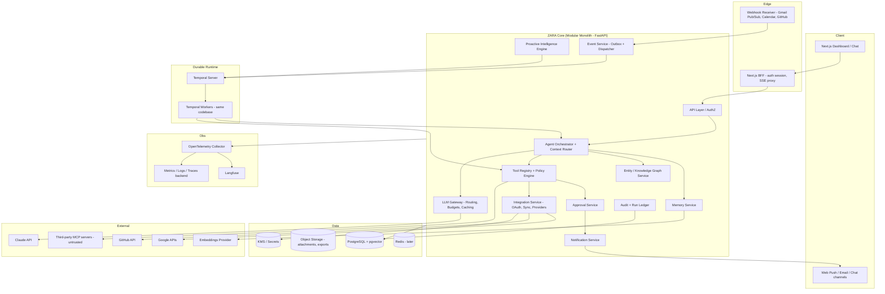
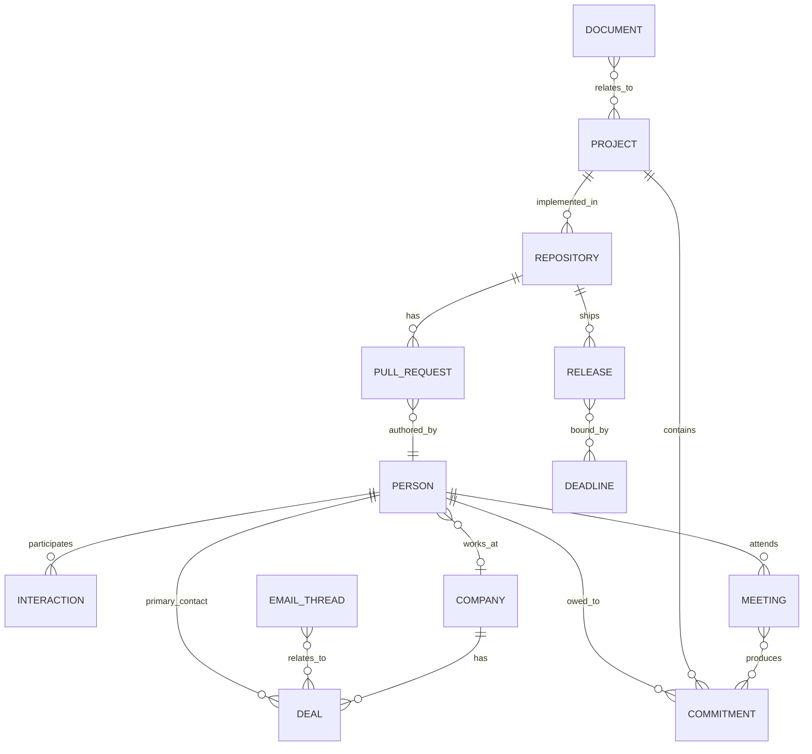
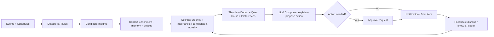
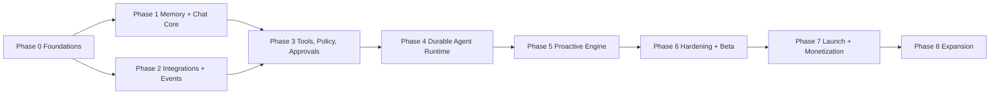

# ZARA — Master Product & System Architecture
**Document status:** Source of truth for all implementation phases (v1.0)
**Scope:** Architecture only. No application code.

---

## 0. Executive Summary & Critical Review of the Proposed Stack

ZARA is a persistent, proactive personal-intelligence agent with one orchestrator, one memory, one permission system, and four *context modules* (Personal, Executive, Sales, Developer). The right shape is a **modular monolith plus a durable workflow engine**, not an agent framework with four bots.

### Verdict on each proposed technology

| Technology | Verdict | Reasoning |
|---|---|---|
| Next.js + TypeScript + Tailwind + shadcn/ui | **Keep** | Standard, productive, good for dashboards. Use it as a thin UI/BFF only. No business logic in Next.js route handlers. |
| FastAPI + Python | **Keep** | Best ecosystem for LLM, embeddings, and Google/GitHub SDKs. Async-friendly. |
| PostgreSQL | **Keep (single source of truth)** | Relational data, JSONB, full-text search, vectors, queues, audit, RLS for multi-tenancy. |
| pgvector | **Keep** | Enough up to low millions of vectors per deployment. Pair with `tsvector` for hybrid search. Avoid a separate vector DB. |
| Temporal | **Keep, but staged** | The correct tool for durable, recoverable, long-running, human-in-the-loop workflows. It is operationally heavy, so use Temporal Cloud or a single self-hosted service from day one only for workflows that truly need durability. See §14. |
| LangGraph | **Downgrade to optional / narrow use** | It overlaps with Temporal for durability and state. Using both as "orchestrators" creates two sources of truth for workflow state. Recommendation: **Temporal owns durable orchestration; the agent reasoning loop is a small in-house loop (or LangGraph used strictly inside a single Temporal activity as a reasoning step) with no LangGraph checkpointer persistence.** Start with a plain tool-use loop on the Claude API; adopt LangGraph only if multi-agent graph patterns genuinely emerge. |
| Redis | **Defer / narrow** | Not needed for MVP. Postgres handles queues (`SKIP LOCKED`), rate limits, and cache adequately at this scale. Add Redis later for rate limiting, SSE fan-out/pub-sub, and hot caches. Temporal does not need Redis. |
| Claude API | **Keep** | Strong tool use and long context. Important gap: **Anthropic has no embeddings model.** Use a dedicated embeddings provider (e.g., Voyage AI) or a self-hosted open model. This is an explicit decision (§6). |
| MCP + native APIs | **Hybrid, with a hard rule** | Native, first-party-coded integrations for Gmail, Calendar, Drive, GitHub (core path: security, idempotency, rate limits, webhooks). MCP **only** as an extension mechanism for long-tail third-party tools, wrapped in the same permission layer, with every MCP server treated as untrusted. |
| Docker Compose | **Keep for dev and single-node deploy** | Not a production scaling answer. Plan for managed containers (Fly/Render/ECS/Cloud Run) with the same images. |
| OpenTelemetry | **Keep** | Vendor-neutral traces/metrics/logs across API, workers, and Temporal. |
| Langfuse | **Keep, but use hosted first** | Self-hosting Langfuse v3 brings ClickHouse, Redis, and S3 — a heavy ops burden. Use Langfuse Cloud (or defer) and keep OTel as the backbone so Langfuse is swappable. The agent run/audit log in Postgres remains the system of record. |

### Additions the proposal is missing
1. **Embeddings provider** (decision required, see above).
2. **Transactional outbox + event bus table** in Postgres for reliable event handling.
3. **Secrets/KMS layer** for OAuth token encryption (envelope encryption).
4. **Prompt-injection defense architecture** (taint tracking, privilege separation) — the single biggest security risk for an agent that reads email and acts on it.
5. **Evaluation harness** (golden datasets, replay) as a first-class component.
6. **Notification channel service** (web push, email, optionally Telegram/Slack/WhatsApp).

### Things deliberately NOT added
Kubernetes, Kafka, a graph database (Neo4j), a standalone vector DB, microservices, a separate feature store. Each can be introduced when a measured need exists.

---

## 1. Product Requirements & User Personas

### 1.1 Personas
| Persona | Description | Primary value from ZARA |
|---|---|---|
| **Founder / Operator (primary, MVP)** | Solo founder or small-team lead juggling product, sales, and engineering | Single daily briefing, meeting prep, follow-up tracking, repo awareness |
| **Executive / Manager** | Meeting-heavy, decision-driven | Calendar intelligence, commitments tracking, prioritization |
| **Sales Professional** | Pipeline and relationship-focused | Prospect context, follow-up reminders, outreach drafts |
| **Independent Developer / Eng Lead** | Repo, PR, release focused | PR/issue triage, release readiness, deadline awareness |
| **Power User (personal)** | Wants a memory-aware assistant | Routines, reminders, relationship memory |

MVP targets the **Founder/Operator** because the persona naturally spans all four domains, which validates the unified-context thesis.

### 1.2 Core user journeys
1. **Morning briefing:** Overnight emails, today's meetings with attendee context, PRs awaiting review, deals needing follow-up, personal reminders — one prioritized brief.
2. **Meeting prep:** 30 minutes before a meeting, ZARA assembles attendee history, last email threads, open commitments, related CRM/GitHub context.
3. **Commitment capture:** "I'll send the proposal by Friday" in an email or meeting note becomes a tracked commitment with a reminder and draft.
4. **Proactive follow-up:** A prospect has gone silent for 5 days; ZARA drafts a follow-up and asks for approval.
5. **Developer awareness:** A PR blocking a release has been stale for 3 days, and the release deadline is Thursday → surfaced with context.
6. **Memory control:** User views, edits, deletes, or pins what ZARA knows.

---

## 2. Functional & Non-Functional Requirements

### 2.1 Functional requirements
- **FR-1 Memory:** Persistent episodic, semantic, and procedural memory; user-viewable/editable/deletable; provenance on every memory.
- **FR-2 Integrations:** OAuth-based Gmail, Google Calendar, Drive, GitHub; extensible provider interface.
- **FR-3 Conversation:** Chat with streaming responses and tool use over unified context.
- **FR-4 Autonomy:** Multi-step plans executed in background with durable state.
- **FR-5 Proactivity:** Scheduled and event-triggered insights, with scoring and throttling.
- **FR-6 Approvals:** Tiered action permissions; human-in-the-loop approval via dashboard/notification.
- **FR-7 Notifications:** Multi-channel, preference- and quiet-hours-aware.
- **FR-8 Audit:** Every agent action, tool call, memory write, and approval recorded, queryable, and exportable.
- **FR-9 Recovery:** Workflows resume after crashes/deploys; failed steps retried or escalated.
- **FR-10 Controls:** Pause/kill switch per agent, per integration, and globally.

### 2.2 Non-functional requirements
| Area | Target |
|---|---|
| Availability | 99.5% MVP, 99.9% GA for core API; background runtime independent of UI |
| Latency | Chat first token < 2 s p95; retrieval < 300 ms p95; tool actions async with status |
| Durability | No lost events; at-least-once ingestion with idempotent processing |
| Security | OWASP ASVS L2 equivalent; encrypted tokens; least-privilege scopes |
| Privacy | User-owned data; export and full deletion within 30 days; no training on user data |
| Cost | Per-user LLM budget with hard caps; target < $X/user/month defined per plan |
| Scalability | Single node → 1k users without re-architecture; schema ready for multi-tenant |
| Observability | 100% of agent runs traced; cost and token attribution per run |
| Compliance readiness | Design for GDPR; SOC 2 controls (audit log, access control) from the start |
| Google restricted scopes | Gmail read scopes require OAuth verification and a CASA security assessment for public launch — plan this in the roadmap |

---

## 3. Overall System Architecture

### 3.1 Style
A **modular monolith** backend (single deployable FastAPI codebase with strict module boundaries) plus **separate process types** from the same codebase: API server, Temporal worker(s), event-ingestion/webhook receiver, scheduler. The frontend is a separate Next.js app.

### 3.2 Architecture diagram



### 3.3 Process types (one codebase, many entrypoints)
1. `zara-api` — HTTP/SSE for UI.
2. `zara-worker` — Temporal workers executing workflows and activities (agent runs, sync jobs, proactive scans).
3. `zara-ingest` — webhook receiver and polling fallback; writes to the outbox and returns fast.
4. `zara-scheduler` — Temporal Schedules (not cron) trigger recurring jobs; no custom scheduler process needed beyond Temporal.

This lets the product keep running when the dashboard is closed: only the UI is disposable.

---

## 4. Agent Orchestration Architecture

### 4.1 Principles
- **One orchestrator**, many *capabilities*. Domains are context modules and tool bundles, not agents.
- The orchestrator is an **LLM tool-use loop wrapped in a durable workflow**.
- Strict **separation of planning, acting, and verification**.

### 4.2 Run types
| Run type | Trigger | Execution |
|---|---|---|
| Interactive turn | User message | API process, streaming; side-effect actions handed off to Temporal |
| Background task | Plan step, event, schedule | Temporal workflow → activities |
| Proactive scan | Schedule / event | Temporal workflow with scoring |
| Maintenance | Nightly | Memory consolidation, sync repair, cost rollup |

### 4.3 The agent loop (conceptual)
1. **Intake:** Normalize input (user message, event, or schedule) into a `Run` with a goal, trigger provenance, and trust labels.
2. **Context assembly:** Context Router selects domain modules and retrieves memory/entities (§5, §7).
3. **Plan:** Model proposes a plan (for non-trivial goals) stored as a structured `Plan` with steps, required tools, and risk tier.
4. **Act:** Execute steps via the Tool Registry. Each tool call passes the Policy Engine.
5. **Observe:** Tool outputs are wrapped as **untrusted data** before entering context.
6. **Verify/Reflect:** Check results against the goal; replan or finish.
7. **Commit:** Write memories, update entities, emit events, notify, finalize the run ledger.

### 4.4 Model roles inside the single orchestrator
Not separate agents — separate *prompts/models* used by the same loop:
- **Router/classifier** (small, cheap model): intent, domain relevance, risk pre-screen.
- **Planner/reasoner** (mid or large model): multi-step planning.
- **Executor** (mid model): tool selection and argument construction.
- **Extractor** (small model): memory and entity extraction.
- **Summarizer** (small model): briefs, consolidation.
- **Safety reviewer** (independent call, different prompt): reviews proposed high-risk actions against policy and provenance.

### 4.5 Loop limits and safety
- Maximum steps, tokens, wall-clock, and tool-call budgets per run.
- Loop and repetition detection.
- Run states: `queued → running → awaiting_approval → paused → succeeded | failed | cancelled`.
- Every state transition is persisted.

---

## 5. Context Routing Across the Four Domains

### 5.1 Concept
There is **one memory and one entity graph**. A *domain* is a **lens**: a set of (a) entity types, (b) retrieval filters/boosts, (c) tools, (d) prompt fragments, and (e) proactive rules.

| Domain | Core entities | Tool bundle | Proactive rules (examples) |
|---|---|---|---|
| Personal | Person, Routine, Preference, Goal, Reminder, Place | Reminders, notes, calendar (personal) | Birthday, routine drift, goal check-ins |
| Executive | Meeting, Commitment, Decision, Priority, Project | Calendar, email, Drive | Meeting prep, overdue commitments, schedule conflicts |
| Sales | Contact, Company, Lead, Deal, Interaction | Email, CRM adapter, Drive | Stale leads, follow-up due, deal risk |
| Developer | Repository, PR, Issue, Release, Deadline | GitHub, Drive | Stale PRs, failing CI, release risk |

### 5.2 Routing algorithm
1. **Signal extraction:** Entities mentioned (resolved via the entity graph), intent, time references, source integration.
2. **Domain scoring:** Each domain gets a relevance score from (a) classifier output, (b) entity types matched, (c) source system, (d) recent activity. Scores are **not exclusive**.
3. **Context expansion (cross-domain):** Follow entity links. Example: a calendar attendee (Executive) resolves to a Contact (Sales) with an open Deal and a shared GitHub repo (Developer). The router pulls all three.
4. **Budgeted assembly:** A context budget (tokens) is split across: system/policy, user profile, retrieved memories, entity cards, recent events, tool outputs. Higher-scored domains get larger share.
5. **Tool exposure:** Only tools from relevant domains are presented (reduces errors and prompt-injection surface), plus always-on core tools (memory, reminders).
6. **Trace:** The routing decision (scores, entities, included items) is logged for debugging and evaluation.

The key unifier is the **entity graph**: cross-domain reasoning is graph traversal plus retrieval, not agent-to-agent messaging.

---

## 6. Memory Architecture

### 6.1 Memory types
| Type | Content | Storage |
|---|---|---|
| **Working** | Current run context | In-process, ephemeral; summary persisted in run ledger |
| **Episodic** | Time-stamped events/interactions ("met Priya on Nov 12, she asked about pricing") | `memory_items` (type=episodic) + embeddings |
| **Semantic** | Durable facts/preferences ("prefers morning meetings", "Priya is CFO at Acme") | `memory_items` (type=semantic) + entity links |
| **Procedural** | Learned workflows/preferences on how to act ("always CC assistant on investor emails") | `memory_items` (type=procedural), user-confirmed |
| **Profile** | Structured settings, goals, working hours | Relational tables |
| **Source documents** | Raw emails, docs, PRs (chunked, indexed) | `documents` + `chunks` with embeddings; retained per policy |

### 6.2 Memory record (conceptual fields)
`id, user_id, type, content, structured_payload, entities[], importance, confidence, sensitivity, source_ref (integration, message id, run id), created_at, last_accessed_at, access_count, valid_from, valid_to, supersedes_id, status (active|superseded|archived|deleted), user_pinned, user_edited, embedding`

### 6.3 Embeddings decision
- Claude has no embeddings endpoint. Choose **one** provider (e.g., Voyage `voyage-3`-class, or open model such as BGE/E5 self-hosted).
- Store `embedding_model` and `embedding_version` per row to enable re-embedding migrations.
- Use dimension-appropriate pgvector indexes (HNSW) and keep the model abstraction behind an `EmbeddingProvider` interface.

### 6.4 Extraction (write path)
1. **Trigger:** end of run, new document ingestion, or periodic batch.
2. **Extractor LLM** emits candidate memories and entity mentions in a structured schema.
3. **Gates:**
   - **Provenance gate:** every candidate must cite a source span.
   - **Trust gate:** content derived from untrusted external text (e.g., an inbound email) can create *observations about that source* but **cannot** create procedural memory or modify user preferences. Prevents memory poisoning via injected email.
   - **Sensitivity classification:** health, financial, credentials → restricted handling; credentials/secrets never stored as memory.
   - **Dedup/merge:** vector similarity + entity match against existing memories; update, supersede, or add.
4. **Confidence thresholds:** low-confidence candidates go to a "suggested memories" inbox for user confirmation instead of being silently saved.

### 6.5 Consolidation
Nightly Temporal workflow:
- Merge near-duplicates; resolve contradictions using recency, source authority, and user-edit priority (user-edited memories always win).
- Roll up episodic clusters into semantic summaries ("last 6 interactions with Acme → relationship summary") while retaining links to the sources.
- Recompute importance scores.
- Mark superseded memories; never hard-overwrite (keeps history).

### 6.6 Retrieval (read path)
Hybrid retrieval:
1. **Candidate generation:** vector similarity + BM25-style (`tsvector`) + entity-linked memories + recency window + pinned memories.
2. **Scoring:** `score = w1·semantic + w2·lexical + w3·recency_decay + w4·importance + w5·entity_overlap + w6·domain_boost`, weights tuned via evals.
3. **Re-rank:** optional cross-encoder or small-LLM rerank for top-N when budget allows.
4. **Diversity + budget packing:** MMR to avoid redundancy; pack within the token budget.
5. **Citations:** each included memory carries its ID so the model's answers and the audit trail can reference it.

### 6.7 Forgetting policy
- **Decay, not deletion:** importance decays with time and non-use; below threshold → archived (excluded from default retrieval, still searchable by the user).
- **TTL classes:** ephemeral (e.g., "meeting at 3pm today") expire automatically; durable facts persist until superseded.
- **User-driven:** delete one / delete by source / delete by entity / delete all. Deletion cascades to embeddings, derived summaries, and cached contexts, with a tombstone in the audit log (no content).
- **Source disconnect:** disconnecting an integration offers "retain / archive / purge derived data".
- **Regulatory:** GDPR erasure workflow with verification.

### 6.8 User control
Memory dashboard: search, filter by domain/entity/source, edit, pin, delete, see "why was this used?" (retrieval trace), and review suggested memories.

---

## 7. Knowledge Graph & Entity Relationships

### 7.1 Decision
**Relational graph in PostgreSQL**, not Neo4j. At this scale (thousands to low millions of nodes per user base), typed `entities` + `entity_edges` tables with recursive CTEs for 1–3 hop traversal are sufficient and keep one transactional store. Revisit only if multi-hop analytics become a bottleneck.

### 7.2 Schema concept
- `entities(id, user_id, type, canonical_name, aliases[], attributes jsonb, embedding, merged_into_id, created_at)`
- `entity_edges(id, user_id, src_id, dst_id, relation, weight, valid_from, valid_to, source_ref, confidence)`
- `entity_mentions(entity_id, source_type, source_id, span, confidence)` linking to emails, docs, memories, events.

### 7.3 Entity types and key relations


### 7.4 Entity resolution
- Deterministic first: email address, GitHub username, calendar attendee ID, domain.
- Probabilistic second: name similarity + context + embedding; below the threshold → "possible duplicates" review queue.
- Merges are reversible (`merged_into_id`, audit entry).
- Cross-domain linking is what powers "this PR author is also the prospect from yesterday's call."

---

## 8. Tool Registry & Tool Execution

### 8.1 Tool definition (conceptual manifest)
`name, version, description (for the model), input_schema (JSON Schema), output_schema, domain(s), required_scopes, side_effect_class (read | write_reversible | write_external | destructive), risk_tier, idempotency_strategy, rate_limit_policy, timeout, retry_policy, requires_approval_policy, data_egress_class, provider (native | mcp:<server>), output_trust (untrusted by default)`

### 8.2 Execution pipeline (every tool call)
1. **Schema validation** of model-proposed arguments (reject, don't coerce silently).
2. **Policy Engine** check: user permissions, tool allowlist for this run, scope presence, rate/budget, provenance (§15, §17).
3. **Approval gate** if required → run enters `awaiting_approval`; the workflow durably waits for a Temporal signal.
4. **Idempotency key** generation (run_id + step + args hash) to make retries safe.
5. **Execution** in a Temporal activity with timeout and retry policy (retries only for idempotent/safe errors).
6. **Output sanitization:** size limits, content-type handling, wrap as untrusted data, strip active content.
7. **Ledger write:** call, args (redacted), result summary, latency, cost, approval ID.
8. **Compensation:** where possible, tools declare an undo (e.g., delete created draft).

### 8.3 MCP handling
- MCP servers are registered per user/org with explicit capability allowlists.
- Tool descriptions from MCP servers are treated as untrusted (they can contain injection); they are reviewed/pinned at install time and re-verified on change (hash).
- MCP traffic runs through the same Policy Engine and ledger; no direct model→MCP path.
- Prefer native tools for anything touching email, calendar, code, and money.

---

## 9. Integrations Architecture

### 9.1 Provider abstraction
Each integration implements a `Provider` module with: `connect (OAuth)`, `scopes`, `initial_sync`, `incremental_sync`, `subscribe (webhook/watch)`, `normalize (to canonical events/documents/entities)`, `tools`, `health_check`, `revoke`.

### 9.2 Core integrations (MVP)
| Integration | Sync strategy | Real-time | Notes |
|---|---|---|---|
| **Gmail** | Initial window (e.g., 90 days) + `history.list` incremental | Gmail push via Cloud Pub/Sub; `watch` renewed before 7-day expiry; polling fallback | Start with `gmail.readonly` + `gmail.compose` (drafts), not `gmail.send`; sending is a high-risk tool behind approval. Restricted scopes → verification + security assessment before public launch |
| **Google Calendar** | Sync tokens | Watch channels (renewal required) | Event create/update are write_external, approval by tier |
| **Google Drive** | Changes API + page tokens | Push notifications | Prefer `drive.file`/narrow scopes; index only user-selected folders |
| **GitHub** | Webhooks + REST/GraphQL backfill | Webhooks (signature-verified) | Prefer a **GitHub App** over OAuth App for fine-grained, per-repo permissions |

### 9.3 Token and credential management
- OAuth with PKCE where applicable; minimal scopes; incremental authorization.
- Refresh/access tokens **envelope-encrypted** (data key per user, wrapped by KMS key); never logged.
- Token refresh handled centrally with locking to avoid refresh races; revoked/expired tokens → integration marked `needs_reauth` and user notified.
- Per-provider rate-limit budgeters and exponential backoff with jitter.

### 9.4 Normalization
Provider-specific payloads → canonical `events`, `documents/chunks`, `entities`. Raw payloads retained briefly for debugging, then purged per retention policy.

### 9.5 Future integrations
Slack, Notion, HubSpot/Salesforce/Pipedrive, Linear/Jira, Outlook. Added by implementing the provider interface; no core changes.

---

## 10. Proactive Intelligence Engine

### 10.1 Goal
Generate **timely, relevant, low-noise** insights and optional actions without being asked. Noise is the primary failure mode.

### 10.2 Pipeline


### 10.3 Detectors (start deterministic, add LLM judgment later)
- Meeting in N minutes without prep.
- Commitment due within X or overdue.
- Lead/thread silent > N days.
- PR stale / CI failing / release deadline at risk.
- Calendar conflicts, travel gaps, overbooked days.
- Routine/goal drift (Personal).
- Cross-domain: "meeting with X tomorrow; X has an unanswered email and an open deal at risk."

Deterministic detectors first = cheaper, predictable, testable. LLM used for enrichment and composition, with LLM-based anomaly detection as a later phase.

### 10.4 Noise control
- Per-user daily interruption budget; ranking decides what fits.
- Dedup by (insight type, entity, time window).
- Snooze/dismiss feedback adjusts per-detector thresholds.
- Digest vs. immediate channels by urgency.

### 10.5 Autonomy levels
User-configurable per domain/action: **Observe → Suggest → Draft → Act-with-approval → Act-autonomously (limited, low-risk only)**. Defaults conservative.

---

## 11. Event Ingestion & Processing

### 11.1 Event model
Canonical envelope: `event_id, user_id, source (gmail|calendar|github|drive|system|user), type, occurred_at, received_at, payload_ref, dedup_key, trust_level, trace_id`.

### 11.2 Ingestion flow
1. Webhook receiver verifies authenticity (Pub/Sub JWT, GitHub HMAC signature, Calendar channel token), **acks fast**, writes to `inbound_events` + outbox in one transaction.
2. Dispatcher (a Temporal workflow or polling the outbox) starts/signals per-user processing.
3. **Per-user ordering:** serialize processing per `(user, source)` using a Temporal workflow ID keyed on user to avoid races.
4. **Idempotency:** dedup via `dedup_key` unique constraint.
5. **Polling reconciliation:** periodic incremental sync catches missed webhooks (webhooks are hints, not truth).
6. **Dead-letter table** for events that exceed retries, with alerting and replay tooling.

### 11.3 Event processing stages
Normalize → Index (documents/chunks/embeddings) → Extract entities/memories → Run detectors → Emit derived events (e.g., `commitment.detected`) → Trigger workflows.

### 11.4 Transactional outbox
State change and event emission happen in the same DB transaction; a relay publishes to Temporal. Guarantees no lost or phantom events without Kafka.

---

## 12. Background Workers & Persistent Runtime

- **Temporal workers** are the persistent runtime. They run on the server/container platform, independent of the browser.
- **Task queues** separated by workload class: `interactive` (latency sensitive), `background`, `sync` (rate-limit sensitive, low concurrency), `maintenance`.
- **Concurrency controls:** per-user and per-provider concurrency limits to prevent noisy neighbors and API bans.
- **Graceful deploys:** worker versioning (Temporal build IDs) so in-flight workflows complete on compatible code; workflow code must be deterministic; non-deterministic work lives in activities.
- **Heartbeats** for long activities; sensible timeouts for all activities.
- **Kill switches:** global, per-user, per-integration, per-tool via feature flags checked in the Policy Engine.

---

## 13. Durable Workflow Architecture

### 13.1 Key workflows
| Workflow | Description |
|---|---|
| `UserRuntimeWorkflow` (per user, long-lived) | Entity workflow: owns the user's schedules, rate/budget state, pending approvals index; uses `continue_as_new` to bound history |
| `AgentRunWorkflow` | One goal → plan → steps → approvals → result; signals for approval, cancel, new info |
| `IntegrationSyncWorkflow` | Initial and incremental syncs, resumable via cursors |
| `ProactiveScanWorkflow` | Scheduled detector evaluation |
| `BriefingWorkflow` | Compose and deliver the daily brief |
| `MemoryConsolidationWorkflow` | Nightly consolidation and decay |
| `DataDeletionWorkflow` | Verified, auditable erasure |

### 13.2 Human-in-the-loop
`AgentRunWorkflow` reaches an approval step, persists the request, notifies the user, and **waits durably** (hours/days) on a signal with a timeout policy (expire → cancel or escalate). Approval payload is bound to a hash of the exact action so the approved action cannot be altered after approval.

### 13.3 Failure semantics
- Activities retried with backoff for transient errors; non-retryable errors (permission denied, validation) fail fast and trigger replanning or user escalation.
- Sagas/compensation for multi-step external changes.
- Every run has a final state and explanation, never silent failure.

### 13.4 Where LangGraph fits (if used)
Only as the reasoning step *inside* a single activity or a short interactive turn. No LangGraph checkpoint database; Temporal history + the run ledger are the sole durable state.

---

## 14. Permission & Approval System

### 14.1 Action risk tiers
| Tier | Examples | Default policy |
|---|---|---|
| **T0 Read-only (own data)** | Search memory, read calendar | Auto-allow |
| **T1 Internal write** | Save memory, create reminder, create internal note | Auto-allow, logged |
| **T2 Reversible external write** | Create draft email, create calendar hold, create GitHub issue comment draft | Auto-allow or approve per user setting |
| **T3 External communication / commitments** | Send email, accept/decline invites, post comments, open PRs | **Approval required** by default |
| **T4 Destructive / sensitive** | Delete data, merge PRs, share files externally, financial actions, change permissions | **Always explicit approval**, step-up auth optional |

### 14.2 Approval object
`approval_id, run_id, tool, exact_args_hash, rendered_preview (diff/email text), risk_tier, requested_at, expires_at, decision, decided_by, decided_via (channel), decision_context`.
- Previews show *what will happen* in human terms (full email body, recipients).
- Approvals are one-time and bound to the exact args.
- **Standing rules** ("auto-send meeting confirmations to existing contacts") are explicit, scoped, revocable policies — never inferred silently from behavior.

### 14.3 Policy engine inputs
User, org role, tool tier, integration scope, run provenance/taint (§16), time/quiet hours, budget, anomaly signals (e.g., sudden bulk send), kill switches. Output: `allow | require_approval | deny` with reason, recorded in the ledger.

---

## 15. Authentication & Authorization

- **Authentication:** Use a managed IdP (e.g., Clerk, Auth0, WorkOS, or Supabase Auth) rather than hand-rolling. Passkeys/OAuth login, MFA, session management. Evaluate based on B2B needs (SSO/SCIM later via WorkOS-type provider).
- **Sessions:** HTTP-only, secure, same-site cookies at the BFF; short-lived JWT/service tokens to FastAPI; CSRF protection.
- **Authorization model:** Multi-tenant from day one: `tenant (org) → user → resources`. All tables carry `tenant_id`/`user_id`. RBAC for org roles (owner, admin, member), plus resource-level ownership checks.
- **Defense in depth:** PostgreSQL **Row-Level Security** keyed by session variables, in addition to application checks, so a missing `WHERE` clause cannot leak data.
- **Service-to-service:** Workers use scoped service identities, set RLS context per job.
- **Step-up auth** for T4 actions and integration disconnect/data deletion.

---

## 16. Security & Privacy Architecture

### 16.1 Threat model (top threats)
1. **Prompt injection via emails/docs/PRs/web content** (indirect injection) leading to data exfiltration or unauthorized actions.
2. **Memory poisoning** — attacker-controlled content persisted as trusted memory.
3. **OAuth token theft / over-broad scopes.**
4. **Tenant data leakage** through retrieval or caching bugs.
5. **Malicious/compromised MCP servers or tool descriptions.**
6. **Excessive agency** — agent takes harmful actions autonomously.
7. **Webhook spoofing / SSRF** via tools that fetch URLs.
8. **Supply-chain and secrets leakage in logs/traces.**

### 16.2 Prompt-injection defense (core design)
- **Trust labeling:** Every piece of context carries provenance: `system | user | zara_generated | external_untrusted`. External content is placed in clearly delimited data blocks with the instruction: treat as data, never instructions.
- **Taint tracking:** If a run has ingested untrusted content, **write/external tools after that point require elevated policy** (approval) and cannot take arguments that were derived solely from untrusted content without confirmation (e.g., recipient addresses extracted from an email body).
- **Privilege separation ("dual-LLM" pattern):** A *quarantined* extraction call processes untrusted text and returns only schema-constrained structured output (no tool access). The *privileged* orchestrator sees structured results, not raw hostile text, when feasible.
- **Egress controls:** Allowlist of destinations; block sending data to arbitrary URLs; no auto-rendering of remote images/links in the UI (markdown exfil vector); URL-fetch tools run through an SSRF-safe proxy.
- **Output validation:** Detect secrets/PII in outbound actions; DLP check before external sends.
- **Safety reviewer call** for T3/T4 actions comparing the action against the user's original intent and provenance.
- **Canary/regression suite** of injection attacks in the eval harness (§21).

### 16.3 Data protection
- TLS everywhere; encryption at rest (DB, object storage).
- Application-level envelope encryption for OAuth tokens and highly sensitive fields.
- Secrets in a managed secret store; no secrets in env files in production.
- **PII/secret redaction** in logs and traces; configurable prompt/response capture (off or redacted by default in observability).
- Least-privilege DB roles; separate roles for API, worker, migrations.

### 16.4 Privacy
- Clear data inventory, per-integration data scope, retention windows.
- User export (JSON) and deletion (cascade, verified).
- Anthropic API: use zero-data-retention/commercial terms; no training on customer data; subprocessor list and DPA for B2B.
- Region/residency considerations noted for future.

### 16.5 Compliance roadmap
GDPR readiness at MVP; SOC 2 Type I → II when pursuing B2B; Google OAuth verification + CASA assessment for restricted Gmail scopes before public launch.

---

## 17. Frontend & Dashboard Architecture

### 17.1 Structure
Next.js (App Router), TypeScript, Tailwind, shadcn/ui. The frontend is a **thin client**: authentication/session, rendering, streaming, and forms. All business logic lives in FastAPI.

- **API contract:** OpenAPI generated from FastAPI → typed TS client (e.g., openapi-typescript/orval). Single contract source.
- **Streaming:** SSE for chat tokens and run progress (simpler than WebSockets, proxy-friendly). Reconnect with `Last-Event-ID`.
- **State:** TanStack Query for server state; minimal client state.

### 17.2 Key screens
1. **Home / Daily Brief** — prioritized insights across domains.
2. **Chat** — unified conversation with citations to memories/sources and visible tool activity.
3. **Approvals inbox** — previews, approve/edit/reject, standing rules.
4. **Activity & Audit** — run timeline, tool calls, costs, replay.
5. **Memory** — browse/edit/pin/delete, suggested memories, retrieval explanations.
6. **Entities** — people, companies, deals, repos, with cross-domain relationship view.
7. **Integrations** — connect/disconnect, scopes, health, sync status.
8. **Automations & Rules** — proactive detectors, autonomy levels, quiet hours.
9. **Settings** — profile, notifications, data export/deletion, billing.
10. **Admin/Operator (internal)** — runs, DLQ, cost dashboards, kill switches.

### 17.3 UX principles
Show *why* (sources, memory used), show *what ZARA did* (activity feed), make undo/pause obvious, and never present generated content as verified fact without citation.

---

## 18. Database Architecture

### 18.1 Single PostgreSQL cluster (MVP), logically separated schemas
| Schema | Contents |
|---|---|
| `core` | tenants, users, memberships, settings, feature flags |
| `integrations` | connections, encrypted credentials, sync cursors, webhook subscriptions |
| `content` | documents, chunks (with vector + tsvector), attachments metadata |
| `memory` | memory_items, suggestions, retrieval logs |
| `graph` | entities, edges, mentions |
| `agent` | runs, run_steps, plans, tool_calls, approvals, standing_rules |
| `events` | inbound_events, outbox, dead_letters |
| `proactive` | detectors, insights, feedback, notification_log |
| `audit` | append-only audit_log (separate role, no UPDATE/DELETE), partitioned by month |
| `billing` | usage_records, budgets, plans |

Temporal uses its **own** database/persistence (separate logical DB or instance).

### 18.2 Design rules
- UUIDv7 primary keys; `tenant_id`/`user_id` on every row; RLS enabled.
- Time-partition high-volume tables (`events`, `audit_log`, `tool_calls`, `retrieval_logs`).
- Migrations: Alembic, forward-only, reviewed; expand/contract for zero-downtime.
- pgvector HNSW indexes with filtered search in mind (tenant/user filter + `ef_search` tuning); consider partial indexes or per-tenant partitioning at larger scale.
- Soft-delete only where history is needed; hard-delete paths for privacy requests.
- Backups: PITR, tested restores, retention policy; DR runbook.
- Object storage (S3-compatible) for attachments/exports; DB stores references.

### 18.3 When to split
Triggers to move vectors or events elsewhere: sustained p95 retrieval > target after tuning, > ~10M vectors per node, or write amplification from event volume. Not before.

---

## 19. Observability & Tracing

- **OpenTelemetry** instrumentation in API, workers, and Temporal interceptors; a single `trace_id` follows: webhook → event → workflow → agent run → LLM calls → tool calls.
- **Three layers:**
  1. *System telemetry:* metrics (latency, queue depth, error rates, sync lag), logs, traces → Grafana stack or a managed APM.
  2. *LLM observability (Langfuse):* prompts, completions (redacted), tokens, cost, latency, eval scores, prompt versions.
  3. *Agent run ledger (Postgres, system of record):* user-visible audit of what ZARA did and why. Do not rely on Langfuse for compliance-grade audit.
- **Key SLIs:** run success rate, approval turnaround, proactive insight acceptance rate, retrieval latency, webhook-to-processed lag, cost per run, hallucination/groundedness eval score.
- **Alerting:** DLQ growth, token-refresh failures, sync lag, Temporal task queue backlog, cost anomalies, spike in tool denials/injection flags.

---

## 20. Testing & Evaluation Architecture

### 20.1 Classical testing
Unit tests (policy engine, scoring, routing), contract tests per provider (recorded fixtures + sandbox accounts), integration tests with Testcontainers (Postgres, Temporal test server), workflow replay tests for determinism, E2E (Playwright) for approval and chat flows, load tests for retrieval and ingestion.

### 20.2 LLM/agent evaluation
- **Golden datasets** per capability: routing accuracy, extraction precision/recall, retrieval relevance (nDCG/recall@k), briefing quality, tool-selection and argument correctness.
- **Trajectory evals:** replay recorded scenarios with mocked *external services* (not mocked intelligence) and grade end-state + step efficiency + policy compliance.
- **Security evals:** prompt-injection corpus, memory-poisoning attempts, exfiltration attempts; must pass before release (gate).
- **LLM-as-judge** with calibration against human labels; use sparingly and track judge drift.
- **Regression gates in CI:** prompt or model changes run the eval suite; thresholds block merges.
- **Production evals:** sample real runs (with consent), user feedback signals (thumbs, dismissals) feed dashboards.
- **Shadow mode:** new detectors/prompt versions run silently, compared before enabling.

> Note: "No mock responses in the production path" is enforced by architecture: mocks and fixtures exist only in the test harness, via dependency injection of provider interfaces; production wiring has no mock providers and CI checks that fixture modules are not importable in production builds.

---

## 21. Failure Recovery & Reliability

| Failure | Handling |
|---|---|
| Worker crash / deploy | Temporal replays workflow; activities retried; worker versioning |
| LLM API error/timeout/overload | Retry with backoff; fallback model; degrade (queue and retry later); never fabricate output |
| Provider outage / rate limit | Circuit breaker per provider; backoff; user-visible status; resume via cursors |
| Missed webhooks | Reconciliation polling and sync cursors |
| Duplicate delivery | Idempotency keys and dedup constraints |
| Token revoked/expired | `needs_reauth` state, workflows pause (not fail), user notified |
| Partial multi-step failure | Saga compensation or explicit "partially complete" state with user options |
| Poison events | Dead-letter queue, alert, replay tool |
| Bad deploy | Feature flags, canary, fast rollback; DB expand/contract migrations |
| Data corruption/loss | PITR backups, tested restores, audit log for reconstruction |
| Runaway agent | Step/token/cost/time budgets, loop detection, kill switch |
| Cost spike | Per-user and global budget circuit breakers |

Reliability goals: **at-least-once** event processing with **idempotent** handlers; **exactly-once-effect** for external writes via idempotency keys and approval hash binding.

---

## 22. Cost Controls & LLM Routing

### 22.1 LLM Gateway (single choke point)
All model calls go through one internal gateway that provides: model routing, prompt caching, budgets, retries/fallbacks, usage accounting, redaction, and tracing. No component calls the Claude API directly.

### 22.2 Routing tiers
| Task | Model class |
|---|---|
| Intent/domain classification, extraction, summarization, dedup judgments | Small/fast (Haiku-class) |
| Standard chat, tool selection, briefing composition | Mid (Sonnet-class) |
| Complex multi-step planning, ambiguous high-stakes reasoning, safety review of T3/T4 | Larger (Opus-class), used sparingly |

Confirm current model names, pricing, and limits at implementation time (they change), and keep model IDs in config, not code.

### 22.3 Cost levers
- **Prompt caching** for stable system prompts/profile/tool definitions.
- **Context budgeting** and retrieval top-k tuning; summarize rather than re-send long histories.
- **Deterministic-first** detectors; LLM only on candidates.
- **Batch API** for non-urgent work (consolidation, backfills) where available.
- **Per-user/plan budgets:** soft limits (degrade to cheaper models, reduce proactivity) then hard caps; usage dashboard.
- **Backfill throttling:** initial email/doc indexing is the biggest hidden cost — chunk selectively, summarize threads, embed only what is useful, and let the user choose time window/folders.
- **Cost attribution** per run/user/domain/feature for pricing decisions.

---

## 23. Deployment Architecture

### 23.1 Environments
`local (Docker Compose) → staging → production`, with identical images.

### 23.2 Local/dev Compose services
`web (Next.js)`, `api`, `worker`, `ingest`, `postgres (pgvector)`, `temporal` + `temporal-ui`, `otel-collector`, (optional) `langfuse`/`redis`, `mailpit`, `localstack/minio`.

### 23.3 Production path
- **Phase 1 (solo/early):** Managed Postgres (with pgvector), Temporal Cloud (recommended to avoid operating it), containers on Fly.io/Render/Cloud Run/ECS for `api`, `worker`, `ingest`, Next.js on Vercel or the same platform. Object storage, KMS/secret manager, managed OTel/Grafana.
- **Phase 2 (growth):** Autoscaled workers by task-queue depth, read replicas, Redis for rate limiting/pub-sub, CDN/WAF.
- **Phase 3 (scale/enterprise):** Kubernetes only if justified, tenant sharding/cells, regional deployments, private networking, BYOK.
- CI/CD: GitHub Actions → build → test/evals → deploy; IaC with Terraform/Pulumi; secrets via cloud secret manager; image scanning and SBOM.

---

## 24. Scaling Strategy

| Bottleneck | Strategy (in order) |
|---|---|
| API throughput | Horizontal API replicas (stateless) |
| Worker throughput | Scale workers per task queue; per-tenant concurrency limits |
| DB reads | Indexes, caching, read replicas |
| Vector search | HNSW tuning, filtered indexes, partition by tenant, then dedicated vector service if needed |
| Event volume | Partitioning, batch processing, then a streaming backbone (Kafka/Redpanda) only if outbox + Temporal no longer suffices |
| LLM cost/latency | Routing, caching, batching, smaller models |
| Provider rate limits | Per-provider budgeters, queueing, staggered syncs |
| Multi-tenant isolation | RLS → schema/cell isolation for large/enterprise tenants |
| Temporal history growth | `continue_as_new`, child workflows, retention config |

Noisy-neighbor control through fair scheduling and per-tenant quotas is a first-class feature.

---

## 25. Product Monetization Opportunities

| Model | Description |
|---|---|
| **Tiered subscription** | Free/limited (1 integration, daily brief) → Pro (all integrations, proactive engine, higher autonomy) → Team |
| **Usage-based component** | LLM-heavy features (backfills, deep research, high-volume automations) metered or credit-based |
| **Domain packs** | Sales Intelligence pack (CRM connectors, outreach prep), Developer pack (advanced repo analytics), Executive pack |
| **Team/Enterprise** | Shared memory spaces, admin controls, SSO/SCIM, audit exports, BYOK, data residency, SLAs |
| **Integration marketplace / API** | Third-party tools via a vetted MCP/provider marketplace; public API/webhooks |
| **Vertical editions** | Founder, sales leader, engineering manager editions with tuned detectors |
| **Services** | Managed onboarding/custom integrations for enterprise |

Pricing should be informed by measured cost per active user (§22); avoid flat pricing that unlimited-LLM usage can make unprofitable. Trust/safety and reliability are the differentiators, not raw model access.

---

## 26. Risks & Mitigations

| # | Risk | Severity | Mitigation |
|---|---|---|---|
| 1 | Prompt injection / unauthorized actions | Critical | §16.2 defenses, approval gates, taint tracking, injection eval gate |
| 2 | Google restricted-scope verification delays launch | High | Start verification early; use test-user mode for beta; minimize scopes |
| 3 | Complexity overload for solo/small team | High | Modular monolith, staged Temporal use, defer Redis/Langfuse self-host, strict MVP boundary |
| 4 | Dual-orchestrator confusion (Temporal vs LangGraph) | High | Temporal = durable state; LangGraph optional and stateless |
| 5 | LLM cost overrun (esp. backfill) | High | Budgets, selective indexing, routing, caching, batch |
| 6 | Notification fatigue → churn | High | Scoring, throttling, feedback loops, autonomy defaults conservative |
| 7 | Poor retrieval quality / hallucinated memory | High | Provenance-required memory, hybrid retrieval, evals, user-editable memory |
| 8 | Memory poisoning | High | Trust gate on extraction, user confirmation for procedural memory |
| 9 | Tenant data leakage | Critical | RLS, tenant-scoped retrieval tests, per-tenant cache keys |
| 10 | Temporal determinism/versioning mistakes | Medium | Replay tests, worker versioning, code review checklist |
| 11 | Provider API changes/rate limits | Medium | Provider abstraction, contract tests, backoff, monitoring |
| 12 | Vendor lock-in (Claude/Temporal) | Medium | LLM gateway abstraction, OTel, portable data model |
| 13 | Trust deficit ("AI sending emails") | Medium | Draft-first defaults, previews, undo, visible audit |
| 14 | Compliance burden | Medium | Privacy-by-design, early DPA/GDPR, SOC 2 roadmap |
| 15 | Scope creep across four domains | Medium | Domain modules share one core; ship Executive + minimal others first |

---

## 27. Repository Structure Recommendation

Monorepo (single repo, pnpm workspaces for web + uv/poetry for Python).

```
zara/
├── apps/
│   ├── web/                      # Next.js dashboard (thin client + BFF)
│   └── docs/                     # internal/public docs (optional)
├── services/
│   └── core/                     # Python modular monolith
│       ├── pyproject.toml
│       ├── alembic/              # migrations
│       └── zara/
│           ├── api/              # FastAPI routers, deps, SSE
│           ├── auth/             # session/IdP verification, RBAC, RLS context
│           ├── agent/            # orchestrator, loop, planner, run ledger
│           ├── routing/          # context router, domain lenses
│           ├── memory/           # extraction, consolidation, retrieval, forgetting
│           ├── graph/            # entities, edges, resolution
│           ├── tools/            # registry, policy engine, execution pipeline
│           │   └── builtin/      # native tools (gmail, calendar, drive, github, memory…)
│           ├── approvals/        # approval service, standing rules
│           ├── integrations/     # provider interface + gmail/calendar/drive/github
│           ├── events/           # ingestion, outbox, dispatcher, DLQ
│           ├── proactive/        # detectors, scoring, throttling, composer
│           ├── notifications/    # channels, preferences
│           ├── llm/              # gateway, routing, caching, budgets, embeddings iface
│           ├── security/         # trust labels, taint, redaction, crypto, egress
│           ├── workflows/        # Temporal workflows + activities
│           ├── billing/          # usage metering, plans
│           ├── observability/    # otel setup, langfuse hooks
│           ├── domains/          # personal/, executive/, sales/, developer/ lens configs
│           └── entrypoints/      # api.py, worker.py, ingest.py
├── packages/
│   ├── api-client/               # generated TS client from OpenAPI
│   └── ui/                       # shared UI components
├── evals/                        # golden datasets, trajectory evals, security corpus
├── tests/                        # integration/e2e/contract tests, fixtures (test-only)
├── infra/
│   ├── docker/                   # Dockerfiles, compose files
│   ├── terraform/                # IaC
│   └── otel/                     # collector configs
├── docs/
│   ├── architecture/             # this document, ADRs
│   ├── runbooks/
│   └── security/                 # threat model, data inventory
└── .github/workflows/
```

**Boundary rule:** modules communicate through explicit Python interfaces (and import-linter rules); only `tools/` talks to `integrations/`, only `llm/` talks to model providers, only `memory/` writes memory tables. This enforces microservice-like boundaries without microservice cost.

---

## 28. Data Flow Walkthroughs

**A. Incoming email → proactive follow-up**
1. Gmail Pub/Sub push → `ingest` verifies JWT → writes `inbound_event` + outbox (one txn) → 200 OK.
2. Dispatcher signals the user's workflow → `IntegrationSyncWorkflow` fetches via `history.list`.
3. Normalize → store document/chunks → embed → entity resolution (sender → Contact).
4. Quarantined extractor pulls commitments/questions (schema output only).
5. Detectors evaluate (e.g., "asked a question, no reply in 48h").
6. Scoring + throttling → LLM composer drafts a reply via `create_draft` (T2).
7. Notification to user with preview; user approves/edits; send (T3) executes with idempotency key; ledger updated; memory updated with the interaction.

**B. Interactive chat turn**
1. UI → BFF → API (SSE). Router classifies, scores domains, expands entities.
2. Retrieval assembles budgeted context; tools filtered to relevant domains.
3. Loop streams tokens; read tools run inline; write tools → policy engine → approval or Temporal activity.
4. End of run: extraction pipeline queued; run ledger finalized; costs attributed.

**C. Meeting prep**
Scheduled detector (T-30 min) → enrich attendees via graph (Contact → Deal → last threads → shared repo) → compose brief → notify; user feedback logged.

---

## 29. MVP Boundary

### In MVP
- Single-user-capable, multi-tenant-ready schema (RLS on).
- Auth via managed IdP.
- Integrations: **Gmail (read + drafts), Google Calendar, GitHub (read)**. Drive read-only if time permits.
- Memory: episodic + semantic, extraction with provenance, hybrid retrieval, memory dashboard (view/edit/delete).
- Entity graph: Person, Company, Meeting, Commitment, Repo, PR (basic resolution).
- Unified chat with citations and streaming.
- Tool registry + policy engine + approvals (T0–T3), draft-first email.
- Proactive: daily brief, meeting prep, overdue commitments, stale PR, silent-thread follow-up (deterministic detectors).
- Temporal for: sync, agent runs with approvals, scheduled briefs.
- Notifications: web + email.
- Audit/activity log, cost tracking, kill switch.
- OTel tracing + Langfuse (hosted).
- Eval harness with routing, extraction, retrieval, and injection test sets.

### Explicitly out of MVP
Autonomous sending without approval, CRM connectors (HubSpot/Salesforce), MCP third-party marketplace, Slack/WhatsApp channels, voice, mobile app, SSO/SCIM, Redis, Kubernetes, multi-region, billing automation (manual/Stripe basic), custom user-defined detectors, team shared memory.

---

## 30. Phased Roadmap & Dependency Order



| Phase | Deliverables | Depends on | Exit criteria |
|---|---|---|---|
| **0 Foundations** | Monorepo, CI, Docker Compose, Postgres+pgvector, migrations, auth, RLS skeleton, OTel baseline, LLM gateway skeleton, audit log | — | Login works; tenant isolation tests pass; traces visible |
| **1 Memory + Chat Core** | Embedding provider, memory schema, extraction, hybrid retrieval, entity basics, streaming chat, memory UI | 0 | Retrieval evals meet baseline; user can edit/delete memory |
| **2 Integrations + Events** | Provider interface, Gmail/Calendar/GitHub OAuth, token vault, sync, webhooks, outbox, DLQ | 0 | Incremental sync reliable; missed-webhook reconciliation proven |
| **3 Tools, Policy, Approvals** | Tool registry, execution pipeline, policy engine, risk tiers, approvals UI, trust labels/taint | 1, 2 | Injection eval suite passing; every tool call ledgered |
| **4 Durable Agent Runtime** | Temporal workflows (run, sync, user runtime), approval signals, retries, kill switches, budgets | 3 | Crash/deploy mid-run resumes correctly; approvals wait durably |
| **5 Proactive Engine** | Detectors, scoring, throttling, briefing, meeting prep, notifications, feedback loop | 4 | Insight acceptance rate tracked; noise budget enforced |
| **6 Hardening + Beta** | Security review, pen test, load tests, backups/DR drill, privacy export/delete, Google verification submission, cost dashboards | 5 | Production readiness checklist (below) met |
| **7 Launch** | Billing, onboarding, support tooling, status page | 6 | Paying beta users; unit economics measured |
| **8 Expansion** | CRM connectors, Sales/Developer depth, MCP marketplace, team features, SSO, more channels | 7 | Per-roadmap |

Suggested sequencing for a solo founder: Phase 0–1 and 2 can overlap partly; **do not start Phase 5 before Phase 3's security gates pass.**

---

## 31. Production Readiness Criteria

**Security & privacy**
- [ ] Threat model reviewed; third-party pen test completed; critical/high findings fixed
- [ ] Prompt-injection and exfiltration eval suite passing as a release gate
- [ ] Tokens envelope-encrypted; secrets in a managed store; log/trace redaction verified
- [ ] RLS tested with cross-tenant negative tests
- [ ] User data export and verified deletion working end-to-end
- [ ] Google OAuth verification (and security assessment, if required) complete
- [ ] DPA/subprocessor documentation and privacy policy published

**Reliability**
- [ ] Chaos tests: kill workers/DB failover/LLM outage mid-run; workflows recover
- [ ] Idempotency verified for all write tools
- [ ] DLQ, replay tooling, and alerts operational
- [ ] PITR backup restore drill passed; RPO/RTO documented
- [ ] Kill switches (global/user/integration/tool) tested

**Quality**
- [ ] Eval thresholds met for routing, extraction, retrieval, groundedness, tool-use
- [ ] E2E tests for approvals, chat, integrations pass in CI
- [ ] Load test meets latency targets at 3× expected beta load
- [ ] Proactive noise metrics within target (e.g., dismissal rate < agreed threshold)

**Operations**
- [ ] Dashboards and on-call alerts for SLIs; runbooks written
- [ ] Cost per user measured and within plan margins; budget caps enforced
- [ ] Zero-downtime migration and rollback procedure rehearsed
- [ ] Feature flags and canary deploys in place
- [ ] Production path contains no mock providers (CI check)

---

## 32. Architecture Decision Records (initial list to formalize)

1. ADR-001 Modular monolith over microservices
2. ADR-002 Temporal as sole durable-state owner; LangGraph optional/stateless
3. ADR-003 PostgreSQL + pgvector as single store; Redis deferred
4. ADR-004 Embeddings provider selection (Voyage vs self-hosted)
5. ADR-005 Native integrations first; MCP as sandboxed extension
6. ADR-006 Relational entity graph over graph DB
7. ADR-007 Trust labeling, taint tracking, and quarantined-extraction pattern
8. ADR-008 Risk-tiered approval model with hash-bound approvals
9. ADR-009 Managed IdP and RLS multi-tenancy
10. ADR-010 LLM Gateway as the only model-access path
11. ADR-011 Langfuse hosted + OTel backbone; Postgres ledger as audit source of truth
12. ADR-012 GitHub App over OAuth App

---

## 33. Open Questions to Resolve Before Phase 1

1. Embeddings provider and dimension (affects index design).
2. Identity provider choice (cost vs B2B features).
3. Temporal Cloud vs self-hosted for staging/production.
4. Target launch geography (GDPR/residency implications).
5. Whether Gmail **send** is in the first public release or draft-only.
6. Default autonomy levels per domain and onboarding flow for setting them.
7. Beta cohort size (drives Google verification path: test-user cap of 100 vs full verification).

---

*End of document. Subsequent implementation prompts should reference section numbers in this file (e.g., "implement §8 Tool Registry per ADR-005") to keep the build consistent with this architecture.*
