# 02 — Database Design

PostgreSQL 16+, extensions: `pgcrypto`, `pg_trgm`, `vector`, `btree_gin`, `citext`.
Schemas: `core, integrations, content, memory, graph, agent, events, proactive, work, crm, dev, audit, billing`.

## 0. Conventions

- **Notation:** `col type [constraints]`. `PK`, `FK→table(col)`, `NN` = not null, `UQ` = unique.
- **Standard columns** (all tables unless noted): `id uuid PK` (UUIDv7, app-generated), `tenant_id uuid NN FK→core.tenants(id) ON DELETE CASCADE`, `created_at timestamptz NN default now()`, `updated_at timestamptz NN default now()` (trigger `set_updated_at`).
- **User ownership:** tables owned by a user also have `user_id uuid NN FK→core.users(id) ON DELETE CASCADE`.
- **Enums:** implemented as `text` + `CHECK (col IN (...))` (not Postgres ENUM — avoids painful migrations).
- **RLS (every table with `tenant_id`):**
  ```sql
  ALTER TABLE <t> ENABLE ROW LEVEL SECURITY; ALTER TABLE <t> FORCE ROW LEVEL SECURITY;
  CREATE POLICY tenant_isolation ON <t>
    USING (tenant_id = current_setting('app.tenant_id', true)::uuid)
    WITH CHECK (tenant_id = current_setting('app.tenant_id', true)::uuid);
  ```
  Tables owned by a user get an additional policy restricting to `user_id = current_setting('app.user_id', true)::uuid` **except** when `app.role = 'service'` (workers acting for a specific user still set `app.user_id`). DB roles: `zara_migrator` (owner, bypass RLS), `zara_app` (API+worker, RLS enforced), `zara_audit_writer` (INSERT only on `audit.*`), `zara_readonly` (analytics, RLS enforced).
- **Session context:** every DB session/transaction begins with `SELECT set_config('app.tenant_id', :t, true), set_config('app.user_id', :u, true)` via the `db.session.rls_session()` async context manager. A request without it sees zero rows.
- **Soft delete:** only where stated (D-16).
- **JSONB** columns have a documented Pydantic schema in `zara/schemas/jsonb.py`; DB-level `CHECK (jsonb_typeof(col)='object')`.
- **Vectors:** `vector(1024)`.

## 1. ER overview

```mermaid
erDiagram
  TENANTS ||--o{ USERS : has
  USERS ||--|| USER_PROFILES : has
  USERS ||--o{ USER_PREFERENCES : sets
  USERS ||--o{ AUTH_SESSIONS : opens
  USERS ||--o{ INTEGRATIONS : connects
  INTEGRATIONS ||--|| OAUTH_CREDENTIALS : secures
  INTEGRATIONS ||--o{ SYNC_CURSORS : tracks
  INTEGRATIONS ||--o{ DOCUMENTS : ingests
  DOCUMENTS ||--o{ CHUNKS : split_into
  USERS ||--o{ MEMORY_ITEMS : owns
  MEMORY_ITEMS ||--o{ MEMORY_SOURCES : cites
  MEMORY_ITEMS ||--o{ MEMORY_EMBEDDINGS : embedded_as
  MEMORY_ITEMS ||--o{ MEMORY_ENTITY_LINKS : mentions
  ENTITIES ||--o{ MEMORY_ENTITY_LINKS : referenced
  ENTITIES ||--o{ ENTITY_RELATIONSHIPS : src
  ENTITIES ||--o{ ENTITY_RELATIONSHIPS : dst
  ENTITIES ||--o| CONTACTS : specialised_by
  ENTITIES ||--o| PROJECTS : specialised_by
  ENTITIES ||--o| DEV_REPOSITORIES : specialised_by
  CONTACTS ||--o{ LEADS : becomes
  LEADS ||--o{ OPPORTUNITIES : converts
  DEV_REPOSITORIES ||--o{ GITHUB_ACTIVITY : emits
  USERS ||--o{ CONVERSATIONS : has
  CONVERSATIONS ||--o{ MESSAGES : contains
  CONVERSATIONS ||--o{ AGENT_RUNS : triggers
  AGENT_RUNS ||--o{ AGENT_PLANS : plans
  AGENT_RUNS ||--o{ RUN_STEPS : steps
  AGENT_RUNS ||--o{ TOOL_EXECUTIONS : calls
  AGENT_RUNS ||--o{ APPROVALS : requests
  AGENT_RUNS ||--o{ RUN_EVENTS : streams
  AGENT_RUNS ||--o| WORKFLOW_RECORDS : executed_by
  EVENTS ||--o{ OUTBOX : relays
  EVENTS ||--o{ INSIGHTS : triggers
  INSIGHTS ||--o{ NOTIFICATIONS : delivered_as
  INSIGHTS ||--o{ INSIGHT_FEEDBACK : receives
  USERS ||--o{ GOALS : sets
  USERS ||--o{ TASKS : owns
  PROJECTS ||--o{ TASKS : contains
  GOALS ||--o{ TASKS : decomposed_into
```



## 2. Table specifications

### 2.1 `core`

**core.tenants** — `id PK`, `name text NN`, `slug citext UQ NN`, `plan text NN default 'free' CHECK(plan IN ('free','pro','team','enterprise'))`, `status text NN default 'active' CHECK(status IN ('active','suspended','deleting'))`, `created_at`, `updated_at`. _No `tenant_id` column; RLS policy: `id = current_setting('app.tenant_id')`._

**core.users** — `id PK`, `tenant_id FK`, `external_auth_id text NN` (IdP `sub`), `auth_provider text NN`, `email citext NN`, `email_verified bool NN default false`, `display_name text`, `role text NN default 'owner' CHECK(role IN ('owner','admin','member'))`, `status text NN default 'active' CHECK(status IN ('active','disabled','deleting'))`, `last_seen_at timestamptz`, timestamps. **UQ** `(auth_provider, external_auth_id)`; **UQ** `(tenant_id, email)`. Index `(tenant_id)`.

**core.auth_sessions** — `id PK`, `tenant_id`, `user_id FK`, `session_token_hash bytea NN UQ` (SHA-256 of opaque token; we only store hash), `idp_session_id text`, `ip inet`, `user_agent text`, `device_label text`, `created_at`, `last_used_at`, `expires_at timestamptz NN`, `revoked_at timestamptz`, `revoke_reason text`. Index `(user_id, revoked_at)`, `(expires_at)`. _Purpose: server-side session list/revocation for the BFF; JWTs from IdP are verified per request but sessions give "sign out everywhere"._

**core.user_profiles** — `user_id PK FK→users(id)` (1:1), `tenant_id`, `timezone text NN default 'UTC'`, `locale text default 'en'`, `working_hours jsonb NN default '{}'` (e.g. `{"mon":[["09:00","18:00"]],...}`), `quiet_hours jsonb NN default '{}'`, `communication_style text`, `job_title text`, `company text`, `bio_summary text`, `onboarding_state jsonb NN default '{}'`, timestamps.

**core.user_preferences** — `id PK`, `tenant_id`, `user_id`, `namespace text NN` (`'notifications'|'autonomy'|'briefing'|'ui'|'privacy'`), `key text NN`, `value jsonb NN`, `source text NN default 'user' CHECK(source IN ('user','inferred_confirmed','default'))`, timestamps. **UQ** `(user_id, namespace, key)`. _Structured, user-set settings. Soft, learned preferences live in `memory.memory_items` (type=`preference`)._

**core.feature_flags** — `id PK`, `tenant_id NULL` (null=global), `user_id NULL`, `key text NN`, `enabled bool NN`, `config jsonb`, **UQ** `(coalesce(tenant_id,'0000…'), coalesce(user_id,'0000…'), key)`. Includes kill switches: `kill.global`, `kill.user`, `kill.integration.<provider>`, `kill.tool.<name>`.

### 2.2 `integrations`

**integrations.integrations** — `id PK`, `tenant_id`, `user_id`, `provider text NN CHECK(provider IN ('gmail','gcal','gdrive','github'))`, `account_identifier text NN` (email or GitHub login/installation id), `external_account_id text`, `status text NN CHECK(status IN ('pending','active','needs_reauth','paused','error','revoked'))`, `granted_scopes text[] NN`, `settings jsonb NN default '{}'` (e.g. gmail label filter, drive folder ids, github repo allowlist), `last_sync_at`, `last_error text`, `error_count int default 0`, `connected_at`, `revoked_at`, timestamps. **UQ** `(user_id, provider, account_identifier)`. Index `(user_id, provider, status)`.

**integrations.oauth_credentials** — metadata + ciphertext. `id PK`, `tenant_id`, `integration_id FK UQ`, `token_type text`, `access_token_ct bytea`, `refresh_token_ct bytea`, `access_expires_at timestamptz`, `dek_wrapped bytea NN` (data key wrapped by KMS), `kms_key_id text NN`, `enc_version smallint NN default 1`, `rotated_at`, `last_refreshed_at`, `refresh_lock_until timestamptz` (advisory refresh coordination), timestamps. _Only `security.crypto` reads/writes `*_ct`._ DB role `zara_app` has column privilege; API responses never include these.

**integrations.sync_cursors** — `id PK`, `tenant_id`, `integration_id FK`, `resource text NN` (`'gmail_history'|'gcal_sync_token'|'gdrive_page_token'|'github_events'`), `cursor_value text`, `watermark_at timestamptz`, `state jsonb`, `updated_at`. **UQ** `(integration_id, resource)`.

**integrations.webhook_subscriptions** — `id PK`, `tenant_id`, `integration_id FK`, `kind text NN` (`gmail_watch|gcal_channel|gdrive_channel|github_app`), `external_id text` (channel/watch id), `secret_hash bytea` (per-channel token hash), `resource_uri text`, `expires_at timestamptz`, `status text NN default 'active'`, timestamps. Index `(expires_at) WHERE status='active'` (renewal job). **UQ** `(kind, external_id)`.

### 2.3 `content` (ingested source material)

**content.documents** — `id PK`, `tenant_id`, `user_id`, `integration_id FK NULL`, `source_type text NN CHECK(IN ('email_message','email_thread','calendar_event','drive_file','github_pr','github_issue','github_commit','note','chat_attachment'))`, `external_id text NN`, `thread_external_id text`, `title text`, `author_entity_id uuid FK→graph.entities NULL`, `occurred_at timestamptz`, `participants jsonb` (normalized addresses), `labels text[]`, `trust_level text NN default 'external_untrusted' CHECK(IN ('user','zara','external_untrusted'))`, `sensitivity text NN default 'normal' CHECK(IN ('normal','sensitive','restricted'))`, `body_storage text NN CHECK(IN ('inline','object'))`, `body_text text` (nullable when stored in object store), `body_object_key text`, `content_hash bytea NN`, `retention_until timestamptz`, `raw_purge_at timestamptz`, timestamps. **UQ** `(user_id, source_type, external_id)`. Indexes `(user_id, source_type, occurred_at DESC)`, `(thread_external_id)`, GIN `participants`.

**content.chunks** — `id PK`, `tenant_id`, `user_id`, `document_id FK ON DELETE CASCADE`, `chunk_index int NN`, `text text NN`, `token_count int`, `embedding vector(1024)`, `embedding_model text`, `embedding_version smallint`, `tsv tsvector GENERATED ALWAYS AS (to_tsvector('english', text)) STORED`, `created_at`. **UQ** `(document_id, chunk_index)`. Indexes: HNSW on `embedding`, GIN on `tsv`, btree `(user_id, document_id)`.

### 2.4 `memory`

**memory.memory_items** — core record (see 03 for semantics).
`id PK`, `tenant_id`, `user_id`,
`kind text NN CHECK(kind IN ('episodic','semantic','preference','goal','relationship','project','commitment','procedural'))`,
`title text`, `content text NN` (canonical natural-language statement), `payload jsonb NN default '{}'` (kind-specific structure),
`importance real NN CHECK(0..1)`, `confidence real NN CHECK(0..1)`, `sensitivity text NN default 'normal'`,
`trust_level text NN CHECK(IN ('user','zara','external_untrusted'))`,
`status text NN default 'active' CHECK(IN ('suggested','active','superseded','archived','expired','deleted'))`,
`user_pinned bool NN default false`, `user_edited bool NN default false`,
`valid_from timestamptz`, `valid_to timestamptz`, `occurred_at timestamptz` (episodic event time), `expires_at timestamptz`, `due_at timestamptz` (commitments),
`supersedes_id uuid FK→memory_items NULL`, `canonical_key text` (dedup key, e.g. `pref:meeting_time`), `content_hash bytea NN`,
`access_count int NN default 0`, `last_accessed_at timestamptz`, `decay_score real NN default 1.0`,
`tsv tsvector GENERATED ALWAYS AS (to_tsvector('english', coalesce(title,'')||' '||content)) STORED`,
`created_by text NN CHECK(IN ('extractor','user','consolidation','system'))`, `extraction_run_id uuid`, timestamps.
Indexes: `(user_id, kind, status)`, `(user_id, canonical_key) WHERE status='active'`, `(user_id, due_at) WHERE kind='commitment' AND status='active'`, `(user_id, expires_at) WHERE expires_at IS NOT NULL`, GIN `tsv`, `(user_id, last_accessed_at)`.
Constraints: `CHECK (NOT (trust_level='external_untrusted' AND kind IN ('procedural','preference')))` — trust gate at DB level; `CHECK (valid_to IS NULL OR valid_from IS NULL OR valid_to >= valid_from)`; `CHECK (status<>'active' OR confidence >= 0.0)`.

**memory.memory_sources** — provenance (≥1 required for non-user-created items, enforced in service layer + deferred constraint trigger).
`id PK`, `tenant_id`, `memory_id FK CASCADE`, `source_type text NN` (`'document'|'message'|'agent_run'|'user_edit'|'event'`), `document_id FK NULL`, `message_id FK NULL`, `run_id FK NULL`, `event_id FK NULL`, `span_start int`, `span_end int`, `quote text` (≤300 chars), `observed_at timestamptz NN`, `created_at`. Index `(memory_id)`, `(document_id)`.

**memory.memory_embeddings** — separate table so re-embedding doesn't rewrite hot rows.
`id PK`, `tenant_id`, `user_id`, `memory_id FK CASCADE`, `embedding vector(1024) NN`, `embedding_model text NN`, `embedding_version smallint NN`, `is_current bool NN default true`, `created_at`. **UQ** `(memory_id) WHERE is_current`. HNSW index on `embedding` (partial `WHERE is_current`).

**memory.memory_entity_links** — `memory_id FK CASCADE`, `entity_id FK→graph.entities CASCADE`, `role text` (`subject|object|mentioned`), `tenant_id`; **PK** `(memory_id, entity_id, role)`. Index `(entity_id)`.

**memory.memory_revisions** — history: `id PK`, `tenant_id`, `memory_id FK`, `revision int NN`, `content text`, `payload jsonb`, `changed_by text` (`user|extractor|consolidation`), `change_reason text`, `created_at`. **UQ** `(memory_id, revision)`.

**memory.retrieval_logs** — `id PK`, `tenant_id`, `user_id`, `run_id FK NULL`, `query_text_hash bytea`, `query_redacted text`, `domains text[]`, `candidates jsonb` (id, scores), `selected_ids uuid[]`, `latency_ms int`, `created_at`. Partitioned monthly by `created_at`; 30-day retention.

### 2.5 `graph`

**graph.entities** — `id PK`, `tenant_id`, `user_id`, `type text NN CHECK(IN ('person','company','project','repository','pull_request','issue','release','meeting','deadline','document','topic','place','goal'))`, `canonical_name text NN`, `aliases text[] NN default '{}'`, `identifiers jsonb NN default '{}'` (e.g. `{"emails":["a@b.com"],"github":"octo"}`), `attributes jsonb NN default '{}'`, `embedding vector(1024)`, `merged_into_id uuid FK→entities NULL`, `confidence real NN default 1.0`, `first_seen_at`, `last_seen_at`, `status text NN default 'active' CHECK(IN ('active','merged','archived'))`, `tsv` on name+aliases, timestamps.
Indexes: `(user_id, type, status)`, GIN `identifiers jsonb_path_ops`, GIN `aliases`, trigram GIN on `canonical_name`, HNSW on `embedding`. Functional UQ for deterministic identity: `UNIQUE (user_id, type, (identifiers->>'primary_key')) WHERE status='active' AND identifiers ? 'primary_key'`.

**graph.entity_relationships** — `id PK`, `tenant_id`, `user_id`, `src_entity_id FK`, `dst_entity_id FK`, `relation text NN CHECK(IN ('works_at','attends','authored','owns','assigned_to','relates_to','blocks','part_of','reports_to','introduced_by','primary_contact_of','participates_in','mentions','deadline_for'))`, `weight real NN default 1.0`, `confidence real NN default 1.0`, `valid_from`, `valid_to`, `source_memory_id FK NULL`, `source_document_id FK NULL`, timestamps. **UQ** `(src_entity_id, dst_entity_id, relation, coalesce(valid_from,'-infinity'))`. Indexes `(src_entity_id, relation)`, `(dst_entity_id, relation)`. `CHECK (src_entity_id <> dst_entity_id)`.

**graph.entity_mentions** — `id PK`, `tenant_id`, `entity_id FK`, `document_id FK NULL`, `message_id FK NULL`, `memory_id FK NULL`, `surface_form text`, `confidence real`, `created_at`. Index `(entity_id)`, `(document_id)`.

**graph.merge_candidates** — review queue: `id PK`, `tenant_id`, `user_id`, `entity_a FK`, `entity_b FK`, `score real`, `reasons jsonb`, `status text default 'pending' CHECK(IN ('pending','accepted','rejected'))`, `decided_at`. **UQ** `(least(a,b), greatest(a,b))`.

### 2.6 `agent`

**agent.conversations** — `id PK`, `tenant_id`, `user_id`, `title text`, `title_source text` (`auto|user`), `last_message_at`, `archived_at`, `metadata jsonb`, timestamps. Index `(user_id, last_message_at DESC) WHERE archived_at IS NULL`.

**agent.messages** — `id PK`, `tenant_id`, `conversation_id FK CASCADE`, `user_id`, `role text NN CHECK(IN ('user','assistant','system_notice'))`, `content text NN`, `content_blocks jsonb` (structured blocks: text, citation, tool_card, approval_card), `run_id FK NULL`, `parent_message_id FK NULL`, `token_count int`, `citations jsonb` (memory ids/doc ids), `feedback text CHECK(IN ('up','down'))`, `created_at`. Index `(conversation_id, created_at)`. _Messages are append-only except `feedback`._

**agent.agent_runs** — `id PK`, `tenant_id`, `user_id`, `conversation_id FK NULL`, `trigger_type text NN CHECK(IN ('user_message','event','schedule','proactive','manual','system'))`, `trigger_ref jsonb` (message id / event id / schedule id), `goal text NN`, `status text NN CHECK(IN ('queued','running','awaiting_approval','paused','succeeded','failed','cancelled','expired'))`, `domains text[]`, `routing jsonb` (router output), `taint_level text NN default 'clean' CHECK(IN ('clean','tainted'))`, `autonomy_level text`, `budget jsonb` (max_steps, max_tokens, max_cost_usd, deadline), `usage jsonb` (steps, tokens_in, tokens_out, cost_usd), `state_snapshot jsonb`, `workflow_id text`, `workflow_run_id text`, `trace_id text`, `error jsonb`, `final_output jsonb`, `started_at`, `finished_at`, timestamps. Indexes `(user_id, created_at DESC)`, `(status) WHERE status IN ('queued','running','awaiting_approval','paused')`, `(workflow_id)`, `(trace_id)`.

**agent.agent_plans** — `id PK`, `tenant_id`, `run_id FK CASCADE`, `version int NN` (replans increment), `steps jsonb NN` (array of PlanStep, see 04), `rationale text`, `status text CHECK(IN ('active','superseded','completed','abandoned'))`, `created_at`. **UQ** `(run_id, version)`.

**agent.run_steps** — `id PK`, `tenant_id`, `run_id FK CASCADE`, `seq int NN`, `node text NN` (`route|retrieve|plan|act|verify|commit|...`), `status text`, `input_summary jsonb`, `output_summary jsonb`, `llm_calls jsonb` (role, model, tokens, cost, latency), `started_at`, `finished_at`. **UQ** `(run_id, seq)`.

**agent.run_events** — SSE replay log: `id bigserial PK`, `tenant_id`, `run_id FK CASCADE`, `seq int NN`, `type text NN`, `data jsonb NN`, `created_at`. **UQ** `(run_id, seq)`. Retention 14 days.

**agent.tool_executions** — `id PK`, `tenant_id`, `user_id`, `run_id FK`, `step_id FK NULL`, `tool_name text NN`, `tool_version text NN`, `risk_tier smallint NN CHECK(0..4)`, `args jsonb NN` (redacted for storage; `args_hash bytea NN` is hash of exact args), `idempotency_key text NN`, `policy_decision text NN CHECK(IN ('allow','require_approval','deny'))`, `policy_reasons jsonb`, `approval_id FK NULL`, `status text NN CHECK(IN ('pending','running','succeeded','failed','timed_out','denied','cancelled','compensated'))`, `attempt int NN default 1`, `result_summary jsonb`, `result_ref text` (object store key for large), `error jsonb`, `taint_in bool`, `latency_ms int`, `external_ref text` (e.g. Gmail draft id), `started_at`, `finished_at`, timestamps. **UQ** `(tenant_id, tool_name, idempotency_key)`. Indexes `(run_id)`, `(user_id, created_at DESC)`, `(status)`. Partition monthly.

**agent.approvals** — `id PK`, `tenant_id`, `user_id`, `run_id FK`, `tool_execution_id FK`, `tool_name`, `risk_tier smallint`, `args_hash bytea NN`, `preview jsonb NN` (rendered human-readable action), `reasons jsonb` (why approval needed incl. taint), `status text NN default 'pending' CHECK(IN ('pending','approved','rejected','expired','cancelled','edited_approved'))`, `requested_at`, `expires_at NN`, `decided_at`, `decided_via text` (`web|email_link|push`), `decision_note text`, `edited_args_hash bytea`, `step_up_verified bool default false`, `workflow_id text`, timestamps. Index `(user_id, status, expires_at)`. Constraint: `CHECK (status<>'approved' OR decided_at IS NOT NULL)`.

**agent.standing_rules** — user-defined auto-approve policies: `id PK`, `tenant_id`, `user_id`, `name`, `tool_name text NN`, `conditions jsonb NN` (e.g. recipient domain allowlist, max per day), `max_risk_tier smallint NN CHECK(<=3)` (never 4), `daily_limit int`, `expires_at`, `enabled bool`, `created_via text`, timestamps.

**agent.workflow_records** — `id PK`, `tenant_id`, `user_id`, `workflow_type text NN`, `workflow_id text NN`, `temporal_run_id text`, `task_queue text`, `status text NN CHECK(IN ('running','completed','failed','cancelled','terminated','timed_out','paused'))`, `parent_run_id uuid FK→agent_runs NULL`, `schedule_id text`, `input_summary jsonb`, `result_summary jsonb`, `started_at`, `closed_at`, `last_heartbeat_at`, `build_id text`, timestamps. **UQ** `(workflow_id, temporal_run_id)`. _Mirror of Temporal state for UI queries; Temporal remains source of truth._

**agent.tasks** → in `work` schema (below).

### 2.7 `work` (tasks, goals, projects)

**work.projects** — `id PK`, `tenant_id`, `user_id`, `entity_id FK→graph.entities UQ` (project is an entity), `name text NN`, `description text`, `status text NN CHECK(IN ('planned','active','on_hold','completed','archived'))`, `priority smallint default 3 CHECK(1..5)`, `start_date date`, `target_date date`, `owner_contact_id FK→crm.contacts NULL`, `repository_ids uuid[]`, `metadata jsonb`, timestamps. Index `(user_id, status)`.

**work.goals** — `id PK`, `tenant_id`, `user_id`, `title text NN`, `description text`, `domain text NN CHECK(IN ('personal','executive','sales','developer'))`, `status text CHECK(IN ('active','achieved','abandoned','paused'))`, `target_metric jsonb` (`{"name":"demos_booked","target":20,"unit":"count"}`), `current_value numeric`, `progress_pct numeric(5,2)`, `start_date`, `target_date`, `review_cadence text` (`daily|weekly|monthly`), `last_reviewed_at`, `parent_goal_id FK NULL`, `project_id FK NULL`, `memory_id FK NULL`, timestamps. Index `(user_id, status)`, `(user_id, target_date) WHERE status='active'`.

**work.tasks** — `id PK`, `tenant_id`, `user_id`, `title text NN`, `description text`, `status text NN CHECK(IN ('todo','in_progress','blocked','done','cancelled'))`, `priority smallint default 3`, `due_at timestamptz`, `remind_at timestamptz`, `completed_at`, `source text NN CHECK(IN ('user','agent','commitment','event'))`, `source_ref jsonb`, `goal_id FK NULL`, `project_id FK NULL`, `commitment_memory_id FK NULL`, `contact_id FK NULL`, `recurrence jsonb` (RRULE string), `created_by_run_id FK NULL`, timestamps. Indexes `(user_id, status, due_at)`, `(user_id, remind_at) WHERE status NOT IN ('done','cancelled')`.

### 2.8 `crm`

**crm.contacts** — `id PK`, `tenant_id`, `user_id`, `entity_id FK→graph.entities UQ`, `full_name text NN`, `emails citext[] NN default '{}'`, `phones text[]`, `title text`, `company_entity_id FK NULL`, `company_name text`, `linkedin_url text`, `relationship text CHECK(IN ('prospect','customer','partner','investor','colleague','friend','family','other'))`, `last_interaction_at`, `next_followup_at`, `notes_memory_id FK NULL`, `tags text[]`, timestamps. Indexes GIN `emails`, trigram on `full_name`, `(user_id, next_followup_at)`. **UQ** `(user_id, lower(primary email))` enforced via `identifiers` on entity.

**crm.leads** — `id PK`, `tenant_id`, `user_id`, `contact_id FK`, `source text`, `stage text NN CHECK(IN ('new','contacted','engaged','qualified','unqualified','converted','lost'))`, `score smallint`, `score_reasons jsonb`, `owner_notes text`, `first_contacted_at`, `last_activity_at`, `silent_since timestamptz`, `next_action text`, `next_action_due_at`, timestamps. Index `(user_id, stage)`, `(user_id, last_activity_at)`.

**crm.opportunities** — `id PK`, `tenant_id`, `user_id`, `lead_id FK NULL`, `contact_id FK NN`, `company_entity_id FK NULL`, `name text NN`, `stage text NN CHECK(IN ('discovery','proposal','negotiation','verbal_commit','closed_won','closed_lost'))`, `amount numeric(14,2)`, `currency char(3) default 'USD'`, `probability numeric(4,3)`, `expected_close_date date`, `closed_at`, `loss_reason text`, `last_activity_at`, `risk_flags jsonb`, `thread_document_ids uuid[]`, timestamps. Index `(user_id, stage)`, `(user_id, expected_close_date)`.

**crm.interactions** — `id PK`, `tenant_id`, `user_id`, `contact_id FK`, `opportunity_id FK NULL`, `kind text CHECK(IN ('email_in','email_out','meeting','call','note'))`, `document_id FK NULL`, `occurred_at`, `summary text`, `sentiment text`, timestamps. Index `(contact_id, occurred_at DESC)`.

### 2.9 `dev`

**dev.repositories** — `id PK`, `tenant_id`, `user_id`, `integration_id FK`, `entity_id FK→graph.entities UQ`, `github_repo_id bigint NN`, `full_name text NN` (owner/name), `default_branch text`, `visibility text`, `language text`, `monitored bool NN default true`, `settings jsonb` (stale_pr_days, ignored_branches), `last_synced_at`, `archived bool`, timestamps. **UQ** `(user_id, github_repo_id)`.

**dev.github_activity** — normalized activity: `id PK`, `tenant_id`, `user_id`, `repository_id FK`, `kind text NN CHECK(IN ('pull_request','issue','commit','release','check_run','review','comment','deployment'))`, `external_id text NN`, `number int`, `title text`, `state text` (`open|closed|merged|draft|failing|passing`), `author_login text`, `author_entity_id FK NULL`, `assignees text[]`, `requested_reviewers text[]`, `labels text[]`, `url text`, `head_sha text`, `base_branch text`, `ci_status text`, `additions int`, `deletions int`, `opened_at`, `updated_at_source`, `closed_at`, `merged_at`, `due_at` (milestone/release), `document_id FK NULL`, `raw_ref text`, timestamps. **UQ** `(repository_id, kind, external_id)`. Indexes `(repository_id, kind, state)`, `(user_id, kind, state, updated_at_source DESC)`, GIN `labels`.

### 2.10 `events` and `proactive`

**events.events** — `id PK`, `tenant_id`, `user_id`, `source text NN CHECK(IN ('gmail','gcal','gdrive','github','system','user','schedule'))`, `type text NN` (e.g. `email.received`, `calendar.event.updated`, `github.pr.opened`, `commitment.detected`), `occurred_at`, `received_at default now()`, `dedup_key text NN`, `payload jsonb NN`, `payload_ref text`, `trust_level text NN`, `trace_id text`, `status text NN default 'received' CHECK(IN ('received','normalized','processed','failed','dead'))`, `attempts int default 0`, `last_error text`, `processed_at`. **UQ** `(tenant_id, source, dedup_key)`. Partitioned monthly by `received_at`. Indexes `(user_id, type, occurred_at DESC)`, `(status) WHERE status IN ('received','failed')`.
**events.outbox** — `id bigserial PK`, `tenant_id`, `event_id`, `destination text` (`temporal:signal|temporal:start`), `payload jsonb`, `created_at`, `dispatched_at`, `attempts`, `next_attempt_at`. Index `(next_attempt_at) WHERE dispatched_at IS NULL`.
**events.dead_letters** — `id PK`, `tenant_id`, `event_id`, `reason`, `error jsonb`, `first_failed_at`, `replayed_at`, `replay_count`.

**proactive.detector_configs** — `id PK`, `tenant_id`, `user_id`, `detector text NN`, `enabled bool`, `params jsonb` (thresholds), `autonomy_level text CHECK(IN ('observe','suggest','draft','act_with_approval','act_autonomous'))`, `domain text`, **UQ** `(user_id, detector)`.
**proactive.insights** — `id PK`, `tenant_id`, `user_id`, `detector text NN`, `domain text[]`, `kind text`, `title text NN`, `body text NN`, `evidence jsonb NN` (entity ids, doc ids, memory ids), `importance real`, `urgency real`, `confidence real`, `novelty real`, `score real NN`, `dedup_key text NN`, `status text NN CHECK(IN ('candidate','suppressed','pending_delivery','delivered','dismissed','snoozed','acted','expired'))`, `suppress_reason text`, `snoozed_until`, `expires_at`, `source_event_id FK NULL`, `run_id FK NULL`, `proposed_action jsonb` (tool + args draft), `approval_id FK NULL`, timestamps. **UQ** `(user_id, dedup_key) WHERE status IN ('candidate','pending_delivery','delivered','snoozed')`. Index `(user_id, status, score DESC)`.
**proactive.notifications** — `id PK`, `tenant_id`, `user_id`, `insight_id FK NULL`, `approval_id FK NULL`, `kind text CHECK(IN ('insight','approval_request','briefing','system','integration_alert'))`, `channel text NN CHECK(IN ('in_app','email','web_push'))`, `title`, `body`, `action_url`, `priority text CHECK(IN ('low','normal','high','urgent'))`, `status text CHECK(IN ('queued','sent','delivered','read','failed','suppressed'))`, `scheduled_for`, `sent_at`, `read_at`, `provider_message_id`, `error`, timestamps. Index `(user_id, status, created_at DESC)`, `(user_id, read_at) WHERE read_at IS NULL`.
**proactive.insight_feedback** — `id PK`, `tenant_id`, `user_id`, `insight_id FK`, `action text CHECK(IN ('useful','not_useful','dismiss','snooze','acted','too_frequent'))`, `note text`, `created_at`. Index `(insight_id)`, `(user_id, created_at)`.
**proactive.notification_budget** — `user_id`, `date`, `count_sent int`, `count_urgent int`; **PK** `(user_id, date)`.

### 2.11 `audit` and `billing`

**audit.audit_log** — append-only. `id uuid PK`, `tenant_id`, `user_id NULL`, `actor_type text NN` (`user|agent|system|admin`), `actor_id text`, `action text NN` (e.g. `tool.executed`, `approval.decided`, `memory.deleted`, `integration.revoked`), `resource_type text`, `resource_id text`, `run_id uuid`, `before_hash bytea`, `after_hash bytea`, `metadata jsonb` (no content, only ids/hashes), `ip inet`, `trace_id text`, `prev_hash bytea`, `row_hash bytea NN` (hash chain: `sha256(prev_hash || canonical_json(row))` per tenant for tamper evidence), `created_at timestamptz NN default now()`. Partitioned monthly. Privileges: `zara_audit_writer` INSERT only; `zara_app` SELECT only (RLS); **no UPDATE/DELETE grant to anyone** (partition drop by migrator only after retention).
**billing.usage_records** — `id PK`, `tenant_id`, `user_id`, `run_id NULL`, `feature text` (`chat|extraction|embedding|briefing|proactive|consolidation`), `role text`, `model text`, `tokens_in int`, `tokens_out int`, `cache_read_tokens int`, `cost_usd numeric(12,6)`, `occurred_at`. Index `(user_id, occurred_at)`. Partition monthly.
**billing.budgets** — `id PK`, `tenant_id`, `user_id NULL`, `period text`, `soft_limit_usd numeric`, `hard_limit_usd numeric`, `spent_usd numeric default 0`, `period_start date`, **UQ** `(user_id, period_start)`.

## 3. SQLAlchemy model specification

- Base: `class Base(DeclarativeBase)` with `metadata = MetaData(schema=None, naming_convention={"ix":"ix_%(column_0_label)s","uq":"uq_%(table_name)s_%(column_0_name)s","ck":"ck_%(table_name)s_%(constraint_name)s","fk":"fk_%(table_name)s_%(column_0_name)s_%(referred_table_name)s","pk":"pk_%(table_name)s"})`.
- Mixins: `UUIDPk` (`id: Mapped[uuid.UUID] = mapped_column(primary_key=True, default=uuid7)`), `TenantScoped` (`tenant_id: Mapped[uuid.UUID] = mapped_column(ForeignKey("core.tenants.id", ondelete="CASCADE"), nullable=False, index=True)`), `UserScoped`, `Timestamps` (`created_at`, `updated_at` with `server_default=func.now()`, `onupdate` handled by DB trigger).
- Each model sets `__table_args__ = {"schema": "<schema>"}` plus its constraints/indexes declared with `Index(..., postgresql_using="hnsw", postgresql_with={...}, postgresql_ops={...})`.
- Type mapping: `jsonb→JSONB`, `text[]→ARRAY(Text)`, `vector→pgvector.sqlalchemy.Vector(1024)`, `tsvector→TSVECTOR` with `Computed(...)`, `citext→CITEXT`.
- Repositories (`zara/<module>/repo.py`) are the only code issuing SQL for their tables; they take an `AsyncSession` already inside `rls_session`.
- Pydantic models in `zara/schemas/` mirror each table for API; never return ORM objects from routers.
- Model files: `models/core.py, integrations.py, content.py, memory.py, graph.py, agent.py, work.py, crm.py, dev.py, events.py, proactive.py, audit.py, billing.py`.

## 4. Alembic migration design

- Single linear history, forward-only; `downgrade()` implemented for dev only and not relied on in prod.
- Environment: `alembic/env.py` uses the `zara_migrator` URL, `include_schemas=True`, `version_table_schema='core'`.
- Naming: `NNNN_<slug>.py`.

| Rev                           | Content                                                                                                                         |
| ----------------------------- | ------------------------------------------------------------------------------------------------------------------------------- |
| 0001_extensions_schemas_roles | Extensions, schemas, DB roles/grants, `set_updated_at()` trigger fn, `uuid_v7_check` helper                                     |
| 0002_core                     | tenants, users, auth_sessions, user_profiles, user_preferences, feature_flags + RLS                                             |
| 0003_audit                    | audit_log (partitioned), hash-chain trigger, privileges                                                                         |
| 0004_integrations             | integrations, oauth_credentials, sync_cursors, webhook_subscriptions                                                            |
| 0005_events                   | events (partitioned), outbox, dead_letters                                                                                      |
| 0006_content                  | documents, chunks (+ HNSW, GIN)                                                                                                 |
| 0007_graph                    | entities, relationships, mentions, merge_candidates                                                                             |
| 0008_memory                   | memory_items, sources, embeddings, entity_links, revisions, retrieval_logs                                                      |
| 0009_agent                    | conversations, messages, agent_runs, plans, run_steps, run_events, tool_executions, approvals, standing_rules, workflow_records |
| 0010_work_crm_dev             | projects, goals, tasks, contacts, leads, opportunities, interactions, repositories, github_activity                             |
| 0011_proactive                | detector_configs, insights, notifications, feedback, notification_budget                                                        |
| 0012_billing                  | usage_records, budgets                                                                                                          |
| 0013_partition_maintenance    | `pg_partman` (if available) or Temporal maintenance workflow to pre-create next 3 monthly partitions                            |

**Rules:** (1) RLS policies created in the _same_ migration as the table. (2) Index creation on populated tables uses `CREATE INDEX CONCURRENTLY` in separate non-transactional migrations. (3) Expand/contract: add nullable column → backfill → enforce NOT NULL in later release. (4) CI test: migrate from empty to head, then run `alembic check` for model drift. (5) CI test: every table with `tenant_id` has RLS enabled and forced (query `pg_class.relrowsecurity/relforcerowsecurity`).

## 5. Tenant isolation considerations

- Composite FKs are **not** used for tenant matching (cost), instead: service layer always loads related rows via RLS session; plus DB test asserts no FK pair crosses tenants in fixtures.
- Vector/FTS queries always include `user_id = :u` predicate _and_ rely on RLS; pgvector HNSW post-filtering may return fewer than K rows → set `hnsw.iterative_scan = relaxed_order` (pgvector ≥0.8) and `ef_search=80`; fall back to exact scan if the user has <5k vectors.
- Cache keys, SSE channels, object-store keys all prefixed `t/{tenant_id}/u/{user_id}/`.
- Deleting a tenant: `DataDeletionWorkflow` deletes in dependency order then drops object prefix; audit tombstone retained without content.

## 6. Acceptance criteria — Database

1. `alembic upgrade head` on empty DB succeeds in CI; `alembic check` shows no drift.
2. Cross-tenant read/write attempts via `zara_app` return 0 rows / violate WITH CHECK for **every** tenant-scoped table (generated test iterating `information_schema`).
3. `audit_log` UPDATE/DELETE as `zara_app` and `zara_audit_writer` fail.
4. Trust-gate CHECK rejects `preference` memory with `external_untrusted` trust.
5. Idempotency UQ on `tool_executions` rejects duplicate `(tenant, tool, key)`.
6. HNSW queries with tenant filter return correct top-K on a 100k-row synthetic set at p95 < 150 ms.
7. Partition pre-creation job verified for next 3 months.
