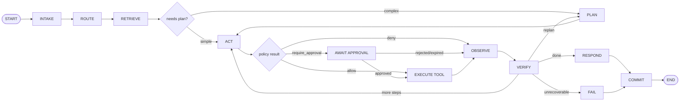

# 04 — Agent State, Graph, and Context Router

## 1. Graph overview (LangGraph, no checkpointer DB — decision D-01)



Nodes are pure async functions `(state, deps) -> state_update`. `deps` is a dependency container (session factory, `llm.gateway`, `tools.pipeline`, `memory`, `graph`, clock). No node imports a provider SDK.

## 2. State schema

Defined as Pydantic v2 models, wrapped in a LangGraph `TypedDict`/`BaseModel` state with reducers. Field names below are binding.

```python
class TrustLabel(StrEnum): SYSTEM="system"; USER="user"; ZARA="zara"; EXTERNAL="external_untrusted"

class Domain(StrEnum): PERSONAL="PERSONAL"; EXECUTIVE="EXECUTIVE"; SALES="SALES"; DEVELOPER="DEVELOPER"

class UserInput(BaseModel):
    kind: Literal["user_message","event","schedule","proactive_goal","resume"]
    text: str | None
    message_id: UUID | None
    event_id: UUID | None
    attachments: list[AttachmentRef] = []
    trust: TrustLabel                      # user_message→USER; event→EXTERNAL; schedule→SYSTEM
    received_at: datetime

class SessionContext(BaseModel):
    tenant_id: UUID; user_id: UUID; run_id: UUID; conversation_id: UUID | None
    trace_id: str
    timezone: str; locale: str; now: datetime        # injected clock — never call datetime.now in nodes
    working_hours: dict; quiet_hours: dict
    autonomy: dict[str, AutonomyLevel]              # per domain
    connected_integrations: dict[str, IntegrationStatus]
    kill_switches: set[str]
    budget: RunBudget                               # max_steps, max_tokens, max_cost_usd, deadline
    recent_messages: list[MessageRef]               # last N turns (summarised beyond N)
    profile_summary: str                            # cached, ~300 tokens

class RoutingDecision(BaseModel):   # see §5
    ...

class RetrievedContext(BaseModel):
    memories: list[RetrievedMemory]
    entities: list[EntityCard]
    documents: list[DocSnippet]          # always trust=EXTERNAL, wrapped
    recent_events: list[EventRef]
    token_usage: dict[str,int]

class PlanStep(BaseModel):
    id: str                               # "s1","s2"
    description: str
    tool: str | None
    args_template: dict | None
    depends_on: list[str] = []
    risk_tier: int                        # computed from tool registry, not LLM
    status: Literal["pending","running","done","failed","skipped","blocked"]
    result_ref: str | None

class Plan(BaseModel):
    version: int; goal: str; steps: list[PlanStep]; rationale: str

class ToolRequest(BaseModel):
    request_id: str; tool: str; args: dict
    derived_from: list[TrustLabel]        # provenance of argument values (taint input)
    idempotency_key: str                  # sha256(run_id, plan_step, canonical_args)
    plan_step_id: str | None

class ToolResult(BaseModel):
    request_id: str
    status: Literal["succeeded","failed","denied","timed_out","pending_approval"]
    output: dict | None                   # schema-validated
    output_text_wrapped: str | None       # what the LLM sees: <untrusted_data tool="..">…</untrusted_data>
    error: ToolError | None
    external_ref: str | None
    latency_ms: int

class VerificationResult(BaseModel):
    goal_satisfied: bool | Literal["partial"]
    issues: list[str]
    groundedness: float                   # claims cited / claims total
    unsupported_claims: list[str]
    next_action: Literal["continue","replan","respond","fail"]

class ApprovalState(BaseModel):
    pending: list[ApprovalRef]
    decisions: dict[UUID, ApprovalDecision]
    blocked_since: datetime | None

class ErrorRecord(BaseModel):
    node: str; kind: Literal["llm","tool","policy","budget","validation","timeout","integration","internal"]
    message: str; retryable: bool; at: datetime; step_id: str | None

class AgentState(BaseModel):
    input: UserInput
    session: SessionContext
    routing: RoutingDecision | None = None
    retrieved: RetrievedContext | None = None
    goal: str | None = None
    plan: Plan | None = None
    scratch: list[Annotated[LLMTurn, add_messages_reducer]] = []   # working memory: model turns within run
    tool_requests: list[ToolRequest] = []        # reducer: append
    tool_results: list[ToolResult] = []          # reducer: append
    verification: VerificationResult | None = None
    approvals: ApprovalState = ApprovalState()
    taint: Literal["clean","tainted"] = "clean"  # monotonic: once tainted, stays tainted for the run
    errors: list[ErrorRecord] = []               # reducer: append
    step_count: int = 0; usage: RunUsage = RunUsage()
    final_output: FinalOutput | None = None      # text blocks + citations + proposed follow-ups
    memory_writes: list[MemoryCandidate] = []    # queued for COMMIT node
    status: RunStatus
```

Reducers: lists append-only (`tool_requests`, `tool_results`, `errors`); `taint` uses `max` (clean<tainted); `usage` sums; all other fields last-write-wins.

## 3. Prompt assembly rules (security-relevant)

System prompt sections, in order: (1) fixed ZARA policy & behavior; (2) profile summary; (3) active domain lens fragments; (4) tool definitions (filtered); (5) retrieved memories (trust=zara/user) as `<memory id=…>`; (6) conversation history; (7) **untrusted blocks** `<untrusted_data source="gmail:thread:abc" trust="external_untrusted">…</untrusted_data>` appended in user-role messages only, never in system role; (8) current user request.
Untrusted block rules: escape any closing tag inside content; truncate to per-source budget; strip HTML/scripts; never place instructions after it without restating the user's goal.

## 4. Persistence and checkpointing

| Layer                                     | Stores                                                                                                                                                                                      | When                                                                                                    |
| ----------------------------------------- | ------------------------------------------------------------------------------------------------------------------------------------------------------------------------------------------- | ------------------------------------------------------------------------------------------------------- |
| `agent.agent_runs.state_snapshot` (JSONB) | Compact snapshot: routing, goal, plan, step pointers, taint, approvals refs, usage, pending tool_request ids. **Excludes** raw retrieved text and untrusted bodies (re-fetchable via refs). | After every node completion (single UPDATE, ≤64 KB; larger fields spilled to object store with `*_ref`) |
| `agent.run_steps`                         | Per-node record with LLM call metadata                                                                                                                                                      | Each node                                                                                               |
| `agent.tool_executions`                   | Each tool request/result                                                                                                                                                                    | At policy decision and at completion                                                                    |
| `agent.run_events`                        | SSE event log                                                                                                                                                                               | Each emitted event                                                                                      |
| Temporal workflow history                 | Orchestration progress for background runs                                                                                                                                                  | Automatic                                                                                               |

**Why no LangGraph checkpointer:** a second durable store would duplicate Temporal+Postgres. Recovery path:

1. Background run: `AgentRunWorkflow` executes the graph in **node-sized activities** — `activity: run_node(run_id, node_name)` loads the snapshot, executes exactly one node, writes the new snapshot + step, returns the next node name. The workflow (deterministic) loops over node names and handles approval waits (signal) and cancellation. A crash resumes at the next unexecuted node. Nodes are idempotent per `(run_id, seq)` (UQ on `run_steps`).
2. Interactive run: executes in-process with the same node functions via a thin local driver (no Temporal) as long as it stays read-only/T≤1 and <30 s. At first T2+ tool request, approval need, or time overrun, the driver **promotes** the run: writes snapshot, starts `AgentRunWorkflow(run_id, resume_at=node)`, emits SSE `run.promoted`; the SSE stream re-attaches via `run_events`.
3. LangGraph is used for graph definition/conditional edges and streaming hooks only; its `MemorySaver` may be used in tests. In production, `compile(checkpointer=None)`.

Snapshot compatibility: `state_snapshot.schema_version`; loader supports N-1; migrations in `agent/state_migrations.py`.

## 5. Context Router

### 5.1 Structured routing schema (LLM + deterministic merge)

```json
{
  "domains": [
    {
      "domain": "EXECUTIVE",
      "score": 0.82,
      "reasons": ["mentions meeting tomorrow", "calendar entity"],
      "primary": true
    },
    {
      "domain": "SALES",
      "score": 0.64,
      "reasons": ["attendee resolves to contact with open opportunity"]
    },
    { "domain": "DEVELOPER", "score": 0.05, "reasons": [] },
    { "domain": "PERSONAL", "score": 0.1, "reasons": [] }
  ],
  "active_domains": ["EXECUTIVE", "SALES"],
  "intent": {
    "label": "prepare_for_meeting",
    "confidence": 0.88,
    "needs_plan": true,
    "write_likely": false
  },
  "entities": [
    {
      "surface": "Priya",
      "type": "person",
      "resolved_entity_id": "ent_priya",
      "resolution": "deterministic",
      "confidence": 0.97
    },
    {
      "surface": "tomorrow 11am",
      "type": "time",
      "value": "2026-11-23T11:00:00+05:30"
    }
  ],
  "time_scope": {
    "start": "2026-11-23T00:00:00+05:30",
    "end": "2026-11-23T23:59:59+05:30"
  },
  "required_integrations": ["gcal", "gmail"],
  "risk_prescreen": { "max_tier": 1, "flags": [] },
  "retrieval_plan": {
    "kinds": ["relationship", "commitment", "episodic", "project"],
    "entity_ids": ["ent_priya"],
    "k": 14,
    "token_budget": 2200
  },
  "fallback_used": null,
  "confidence": 0.84
}
```

Enumerations: `intent.label` ∈ fixed list in `routing/intents.py` (≈40: `answer_question`, `search_memory`, `prepare_for_meeting`, `draft_email`, `schedule_meeting`, `summarize_thread`, `check_pr_status`, `pipeline_review`, `set_reminder`, `track_goal`, `daily_brief`, `chitchat`, …).

### 5.2 Classification logic (3 stages)

**Stage A — deterministic signals (≤20 ms, no LLM):**

- Entity resolution on surface forms (email addresses, `owner/repo`, `#123`, `PR`, known contact names via trigram/alias match).
- Keyword/regex lexicon per domain with weights (`routing/lenses/*.py`), e.g. EXECUTIVE: meeting, calendar, agenda, priorities, decision, commitment; SALES: lead, prospect, deal, proposal, pipeline, follow up, quote; DEVELOPER: PR, pull request, issue, commit, release, CI, repo, deploy; PERSONAL: remind me, birthday, routine, habit, goal, family.
- Source prior: event from `github` → DEVELOPER +0.5; `gcal` → EXECUTIVE +0.5; `gmail` → EXECUTIVE +0.2 (then refined); schedule `daily_brief` → all four 0.5.
- Recent-activity prior: domains used in the last 3 turns +0.1 each (conversation continuity).
- Entity-type signals: person with `crm.contacts` row + open opportunity → SALES +0.3; entity type repository/pr → DEVELOPER +0.5; meeting → EXECUTIVE +0.4; goal/routine → PERSONAL +0.4.

**Stage B — LLM classifier (role=`router`, small model, structured output, ~400 input tokens)** receives: the request, last 3 turns summary, Stage-A signal table, resolved entities. Outputs intent, per-domain scores, `needs_plan`, `write_likely`, time scope, missing-entity hints. Skipped when Stage A is decisive: top domain score ≥0.85 **and** second ≤0.3 **and** intent matched by high-precision rule (e.g., `/remind`, pure "what's on my calendar").

**Stage C — merge & decide:**
`score_d = 0.4·A_d + 0.6·B_d` (if B skipped: `score_d = A_d`).

- Active domains: all with `score_d ≥ 0.35`, max 3; the top is `primary`.
- Cross-domain expansion: for each resolved entity, follow graph edges (≤1 hop, weight ≥0.6) and activate domains of the neighbor entity types if the neighbor was _not_ explicitly mentioned and `score_d(neighbor domain) ≥ 0.2`, marking reason `"graph_expansion"` (counts toward the ≤3 cap but only as secondary).
- `confidence = 0.5·intent.confidence + 0.3·margin(top1-top2 normalized) + 0.2·mean(entity_resolution_conf)`.

### 5.3 Routing fallbacks

| Condition                                        | Behavior                                                                                                                     |
| ------------------------------------------------ | ---------------------------------------------------------------------------------------------------------------------------- |
| Router LLM error/timeout (>1.2 s)                | Use Stage A only; `fallback_used="deterministic_only"`                                                                       |
| `confidence < 0.45` or no domain ≥0.35           | Activate **PERSONAL + primary guess** with core tools only; allow the agent to ask one clarifying question if `write_likely` |
| Required integration disconnected/`needs_reauth` | Route normally but mark `required_integrations` missing; the agent explains and offers to connect (no hallucinated data)     |
| Ambiguous entity (≥2 candidates ≥0.6)            | Ask clarification (chat) / pick none and note ambiguity (background)                                                         |
| Domain kill-switch active                        | Drop that domain's tools; keep its read-only context if allowed                                                              |
| Over-budget (tokens/cost)                        | Reduce `k` and token budget by 50%, skip rerank, continue                                                                    |

### 5.4 Context retrieval strategy (per routing decision)

1. **Always-on:** profile summary, active goals (top 3 by priority), pinned preferences relevant to domains, commitments due ≤3 days or overdue (≤5 items).
2. **Memory retrieval** per 03 §9 with `domains`, `entity_ids`, `kinds` from `retrieval_plan`; token budget split by domain score (primary 50%, others proportional, min 15% each).
3. **Entity cards** (≤6): name, type, role, last interaction, open items; cross-domain card merges CRM + calendar + GitHub facts for the same person.
4. **Documents:** only fetched on demand via tools (read tools) except for event-triggered runs where the triggering doc snippet (≤1.5k tokens, wrapped untrusted) is included.
5. **Recent events:** last 24 h events touching the entities (≤8).
6. **Tool exposure:** `core` tools always; domain bundle tools for active domains; tools requiring disconnected integrations omitted.
7. Persist `routing` into `agent_runs.routing`; emit SSE `route.decided`.

### 5.5 Multi-domain examples

| Request                                                                     | Stage outputs                                                                                                                               | Active                                          | Notes                                                                           |
| --------------------------------------------------------------------------- | ------------------------------------------------------------------------------------------------------------------------------------------- | ----------------------------------------------- | ------------------------------------------------------------------------------- |
| "Prep me for my 11am with Priya"                                            | EXECUTIVE .85 (meeting, calendar); Priya → contact with open opp → SALES .6; Priya shares repo `acme/integration` → DEVELOPER .35 via graph | EXECUTIVE(primary), SALES, DEVELOPER(secondary) | Pulls last email thread, open commitments, deal stage, open PRs by Priya's team |
| "Which PRs are blocking Thursday's release and did I promise anyone a fix?" | DEVELOPER .9; commitment memory → EXECUTIVE .5                                                                                              | DEVELOPER, EXECUTIVE                            | Joins GitHub activity with commitment memories                                  |
| "Remind me to call mom on Sunday and send Rohan the proposal draft"         | PERSONAL .7 (reminder, family); SALES .5 (proposal, contact Rohan)                                                                          | PERSONAL, SALES                                 | Two intents → plan with 2 steps                                                 |
| "How's my week looking?"                                                    | EXECUTIVE .8, PERSONAL .45 (goals, routines)                                                                                                | EXECUTIVE, PERSONAL                             |                                                                                 |
| Event: GitHub `pull_request.opened` by a CRM contact                        | source prior DEVELOPER .5; entity link → SALES .35                                                                                          | DEVELOPER, SALES                                | Insight: "Your prospect opened a PR on your SDK"                                |
| "thanks!"                                                                   | chitchat; all <.1                                                                                                                           | PERSONAL core only                              | No retrieval; cheap model                                                       |

## 6. Acceptance criteria — Agent state & router

1. State round-trips: serialize → store → load → resume produces identical subsequent behavior (property tests, seeded fake LLM in `tests/` only).
2. Killing the worker mid-run (between nodes and mid-node) resumes without duplicate tool executions (idempotency verified via `tool_executions` UQ).
3. Router eval set (`evals/datasets/routing.jsonl`, ≥250 labeled requests incl. ≥80 multi-domain): domain set **F1 ≥ 0.90**, primary-domain accuracy **≥ 0.93**, entity resolution accuracy **≥ 0.92**, deterministic-only fallback F1 **≥ 0.75**.
4. Router p95 latency: **<50 ms** Stage-A-only; **<900 ms** with LLM.
5. Untrusted content never appears in system-role messages (static test on prompt builder + runtime assertion).
6. Taint is monotonic and recorded on `agent_runs` and in each `tool_executions.taint_in`.
7. Run budget enforcement: exceeding max_steps/tokens/cost terminates with `failed` + explicit `budget` error and user-visible message.
